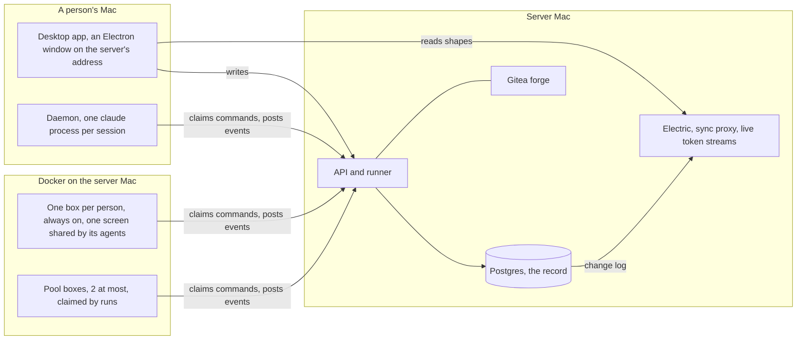
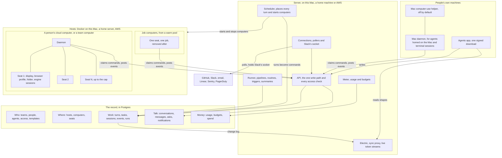

# Target architecture

How every missing feature fits into Agents, decided before building. The goal has three parts, from `docs/intent/multiplayer.md`:

- (A) everything the agent app we studied does, on people's own machines and in the cloud
- (B) the workflow features of the workflow tool we studied
- (C) a team and its agents sharing one record

I wrote this on 2026-10-14 against main at `a553744`, just after the computers and projects branches landed there, and against two branches still landing. A file named with a branch is on that branch, not on main:

- the terminal sessions branch, `.claude/worktrees/agent-ae6bff17618001d52`
- the AWS branch, `.claude/worktrees/agent-a28035877f2a5a41d`

Anything marked new or changed is proposed here and not built. Every row that `docs/intent/feature-checklist.md` marks Partly or Not built has a place in a section below.

## The plan on one page

Most of what Agents lacks comes down to one missing piece. Nothing on the server decides when an agent's turn runs, where it runs, or whether it may run at all. Seven places in the server each write a `message` command straight to a fixed machine, the agent's home or the box a run claimed. So seats, job computers, budgets, agents messaging agents, outside triggers, waking a stopped computer and notifications have nowhere to plug in. The target adds that piece first and builds the rest on it.

1. **Every turn goes through one door.** A person's message, a room, a routine, an outside event, another agent and a pipeline stage each become a row in `turns`, with its source, its agent and who asked. A scheduler on the server checks the budget, picks the place, starts the computer if it is stopped, and only then hands the turn to a machine. A turn that can't run yet waits, and the conversation says why.
2. **Each person keeps one cloud computer, split into seats.** A seat is one agent's display, browser profile, screen stream and folder. Agents on one computer work at once without sharing a screen. A cap sets how many seats a computer holds, and an idle agent's seat goes to the next agent that needs one. Team agents get seats on a team computer.
3. **Parallel coding gets throwaway job computers** from a warm pool, one job each, up to a team limit of 8 by default.
4. **A meter records every turn's usage** by agent, person, source and token type. Budgets are checked before a turn starts, inside it by the engine, and after each usage report.
5. **Agents get tools to message agents, hand them work and create new ones.** Each message is a turn like any other, so it is placed, metered and capped. A chain of agents stops after 4 hops.
6. **Outside events become rows.** GitHub, Slack, email and the rest arrive by polling or over connections the server opens, so nothing gets a public port. Routines and pipelines match them and request turns.
7. **The rest are smaller pieces on the same base.** These are copies and templates with versions, a search page, summaries, notifications, an access panel for each agent, removing a person, more engines and the Mac helper.

What stays: Postgres as the one record, the API as the one write path, sync, live tokens, asks, tasks, pipelines, durability and the coding framework. Agents keep thinking inside each engine's own CLI, on the computer where their tools run. That is decision 1, the largest of the twelve below.

The build starts once the current branches land. First comes the door, with waking a stopped computer, since everything else places turns through it. Seats come next, and their screens can be built beside the door. Seats add no spend, since a box already runs its agents' sessions side by side (`daemon/agentsd.ts:450`), and a seat only stops them sharing one screen. Then the meter and budgets, so spend has a ceiling before agent chains and job computers multiply it. Every step ends in something Tayler can try, with a check that fails before it and passes after.

## Today's shape



- Every agent has one home machine, `agents.home_instance_id`. Seven places write a `message` command straight to it or to a run's box: `server/record.ts:357`, `server/session-messages.ts:41`, `server/rooms.ts:127`, `server/routines.ts:40`, `server/runner.ts:117`, `server/runner.ts:739` and `server/refine.ts:402`. No part of the server decides when or where a turn runs.
- An agent thinks on the machine. The daemon runs one `claude -p` per session (`daemon/claude.ts`) and refuses any other engine (`daemon/agentsd.ts:333`).
- Each person has one box, and it never stops, because `stopIdleBoxes` skips any box a person holds (`server/boxes.ts:204-208`). Runs claim pool boxes, 2 at most unless `AGENTS_MAX_BOXES` says more (`server/boxes.ts:32`).
- A box has one display and one browser (`daemon/desktop.ts:51-53`), which all its agents share one action at a time, within 4 GB, 2 CPUs and 4,096 processes (`server/boxes.ts:45-48`).
- Spend is Claude's running total per session, `sessions.cost_usd` (`server/record.ts:74-82`). Runs add theirs up against their pipeline's cap (`server/runner.ts:265`). Nothing splits spend by person or source.
- Routines fire only on cron (`server/runner.ts:1028`). Outside systems start pipelines through `server/hooks.ts`, on the machine port, inside the tailnet.

## The target shape



| Where | What runs there | What it keeps |
|---|---|---|
| A person's Mac | The Agents app, the daemon for agents homed there, terminal capture, and the helper if its owner turns it on | The person's own engine sign-in and terminal transcripts. Only scrubbed events leave it. |
| The server | API, scheduler, meter, runner, connections, Electric, the sync proxy and the live token streams | Postgres, and each connection's secrets in a file of its own, mode 600 |
| A person's cloud computer | One daemon, and a seat for each agent at work, each with a display, a browser and engine sessions | Agents' folders and browser profiles, and the person's engine sign-ins, on a home volume |
| A team computer | The same, for agents the team shares | The same, signed in to the team's account |
| A job computer | One daemon, one seat, one job | Nothing once the job ends |

The record holds every row in the diagram's record box. Who may do what, where a turn runs and what it cost live nowhere else.

## Seats

A seat is one agent's place on a cloud computer: its own display, its own browser and profile, its own screen stream and the agent's folder. Today a box has one of each. It has display `:1`, one browser with its DevTools port on `127.0.0.1:9222` (`daemon/desktop.ts:51-53`), and one Screen view, shared by every session on the box one action at a time (`daemon/screen.ts`).

**Data shape.**

```ts
// seats, new. One row for each seat a computer has.
type Seat = {
  id: SeatId
  team_id: TeamId
  instance_id: InstanceId     // the computer
  n: number                   // 1 to seat_cap. Display :n and DevTools port 9221 + n, so seat 1 keeps :1 and 9222.
  agent_id: AgentId | null    // the agent holding it, or none
  status: 'free' | 'starting' | 'ready' | 'reclaiming'
  held_since: Date | null
  last_turn_at: Date | null   // what the reclaim rule reads
}
// instances, changed. Gains seat_cap, cpus and memory_gib.
// sessions, changed. Gains seat_id.
// screen_takeovers, changed. Gains seat_id.
```

An agent's browser profile and folder belong to the agent, not to the seat. Both live on the computer's home volume under `agents/<agent id>/`, the folder the daemon already makes for each agent (`agentHome` in `daemon/agentsd.ts`). So a reclaimed seat loses its open pages and keeps its logins.

Secrets for one agent live in its seat's own files. A person sets one from the app through a relay that passes the value to the computer without storing it anywhere, the way the screen relay in `server/screens.ts` passes bytes through the API. Today a value can come only from a machine's environment or `~/.agents-app/secrets.json` (`daemon/agentfiles.ts`), so nobody can give a box one from the app.

**Owner.** `server/seats.ts` (new) owns the rows and the reclaim rule. `daemon/seats.ts` (new) starts and stops each seat's Xvnc, window manager, browser and screen service. Today `daemon/desktop.ts` and `daemon/screen.ts` start one of each for the whole box.

**One action.** Alice messages her agent `scout`, which holds no seat. Her computer has 4 seats. Seats 1 to 3 hold agents with running turns, and seat 4 is free.

1. The scheduler marks seat 4 `starting` for `scout` and sends the computer a `seat_open` command.
2. The daemon starts display `:4`, a browser on port 9225 with `scout`'s profile, and a screen service for `:4`. It reports the seat `ready`.
3. The scheduler places the turn. The daemon starts the session with the `computer` MCP server pointed at `:4` and port 9225.
4. Alice opens Screen on `scout`'s page, and the API pairs her with seat 4's tunnel. If she takes over, seats 1 to 3 keep working.

When every seat is held, the scheduler reclaims the seat whose agent has no running or queued turn and no person on its screen, and whose `last_turn_at` is the oldest and more than 15 minutes ago. An archived agent's seat frees at once, once something archives agents. Nothing sets `agents.archived_at` today. When nothing can be reclaimed, the turn waits, and the conversation shows "Waiting for a seat on Alice's computer, 4 of 4 busy".

A Mac has no seats. Its agents run without a screen, as today, until the helper gives it one (see "People's own machines").

**Stays, changes, new.**

- Stays: the image, Xvnc, matchbox, the browser, the screen service, the takeover state machine in `shared/screen.ts` and the `computer` MCP server, all on main since `a553744`. One computer per person, from `addPersonalBox` in `server/boxes.ts`.
- Changes: one display per box becomes one per seat. `daemon/computer-mcp.ts` takes its display and DevTools port from the session's seat. The Screen routes in `server/screens.ts` name an agent's seat. The 24-hour privacy rule reads the sessions that ran on that seat, not on the whole box, so one agent's private task no longer hides its owner's other agents. The box limits of 4 GB and 2 CPUs become the computer's size (decision 2).
- New: the `seats` table, the seat commands, the reclaim rule, the secret relay, archiving an agent, and a seat list on the computer's page.

Team agents work the same way on a team computer, which has `personal` false, is kept for good, and signs in to the team's account.

## A scheduler places every turn

**Data shape.** The `turns` table exists for room turns (`server/migrations/0001_data_model.sql`, used by `server/rooms.ts`). It becomes the queue for every turn.

```ts
// turns, changed. Every turn an agent is asked to take, not only a room's.
type Turn = {
  id: TurnId
  team_id: TeamId
  agent_id: AgentId
  source: 'person' | 'room' | 'routine' | 'trigger' | 'agent' | 'delegation' | 'pipeline' | 'system' | 'call'
  lane: 'user' | 'agent' | 'background'   // within one agent, user goes first
  conversation_id: ConversationId | null  // exactly one of these three is set
  task_id: TaskId | null
  run_id: RunId | null
  session_id: SessionId | null            // set when the turn is placed
  asked_by_person: PersonId | null
  asked_by_session: SessionId | null      // the agent session that asked, for agent and delegation turns
  chain_id: TurnId                        // the first turn of an agent-to-agent chain, or this turn
  hops: number
  account: PersonId | 'team'              // whose engine sign-in pays
  status: 'queued' | 'waiting' | 'placed' | 'running' | 'done' | 'failed' | 'cancelled'
  wait: 'computer_starting' | 'seat' | 'budget' | 'account_limit' | 'engine' | 'machine_offline' | null
  instance_id: InstanceId | null
  seat_id: SeatId | null
  requested_at: Date
  placed_at: Date | null
  started_at: Date | null                 // exists
  finished_at: Date | null                // exists
  deadline: Date | null                   // exists, for rooms
  outcome: 'sent' | 'pass' | 'skipped' | 'timeout' | 'cancelled' | 'error' | null  // exists, for rooms
}
```

The lifecycle is one transition table in `shared/turns.ts` (new), as the message lifecycle is in `shared/lifecycle.ts`, so no path can move a turn backward.

**Owner.** `server/scheduler.ts` (new) runs in the runner's loop, which ticks every 2 seconds and wakes on `pg_notify` (`server/runner.ts:38-39`). The seven call sites in "Today's shape" call `requestTurn` instead of writing a command, and only the scheduler writes `message` commands.

**Where a turn goes, in this order.**

1. A session that has run before stays on its computer, since the engine's transcript, which resume needs, lives there.
2. A pipeline stage goes where its run's workspace is. That is a job computer, or the agent's computer when the pipeline says `runsOn: 'home'` (`shared/pipeline.ts:198`).
3. One attempt of a task that has several goes to a job computer.
4. Anything else goes to the agent's seat on its computer, which is its owner's computer, a team computer or a Mac.

A turn waits, with its reason, while its computer starts, while no seat is free, while its agent's engine is missing there, while a budget it falls under is spent, while its account is at its plan's limit, or while its Mac is offline. Within one agent, the user lane goes before the agent lane, and both go before background, the order the agent app we studied gives each agent's queue (`docs/evidence/box/box-agent-loop.md` 2.3). One session runs one turn at a time, which the daemon already enforces (`daemon/agentsd.ts:452`). Several sessions of one agent can run at once on its seat, as they do on a box today.

**One action.** `scout`'s 9:00 routine fires while Alice's computer is stopped.

1. `server/routines.ts` writes the routine's post and calls `requestTurn` with source `routine` and lane `background`.
2. The scheduler finds the computer stopped. It marks the turn `waiting` with `computer_starting` and starts the container (`startContainer` in `server/boxes.ts`).
3. The daemon reports its desktop up. The scheduler opens `scout`'s seat and writes the `message` command, with the budget left as `maxBudgetUsd`.
4. The daemon claims the command, and durability keeps it claimed until the turn ends (`server/durability.ts`).
5. The turn's usage event arrives. The meter writes its row, and the turn is `done`.
6. A turn running with no new event for 10 minutes is marked stuck, and the people who asked for it get a notification. Nothing is stopped.

**Stays, changes, new.**

- Stays: commands, claims and durability. Rooms keep taking one turn at a time, with deadlines (`server/rooms.ts`). Runs keep claiming their machine (`server/runner.ts:357`).
- Changes: `agents.home_instance_id` names the agent's computer and no longer decides alone where a turn runs. People's own computers stop when idle and start on a turn, as Tayler decided on 2026-10-14. Nothing does that yet.
- New: `server/scheduler.ts`, `shared/turns.ts`, wait reasons in conversations, the stuck check, and a run history for routines, since every firing is now a turn row. Today a routine keeps only `last_fired_at`.

## Agents creating, messaging and delegating to agents

Today agents work together only in rooms (`server/rooms.ts`). An engine's own subagents land in the record under the call that started them (`events.parent_tool_use_id`). The team-record tools can't reach another agent. `daemon/record-mcp.ts` registers `search_record`, `read_session`, `ready_tasks`, `recent_activity`, `pipeline_history`, `update_memory`, `agent_profile` and `log_decision`, which read and remember. `createAgent` is reachable only by a person (`server/agents.ts`). `sessions.started_by_session` is in the schema, and nothing sets it.

**Data shape.**

```ts
// conversations.kind, changed. Gains 'agents', a thread between two agents that the team can read.
// messages, exists. Holds speaker 'agent', agent_id, and quoted_message_id for a reply.
// events, changed. Gains author_agent, the agent that wrote a user event into another agent's session.
// turns, changed, as above. Source 'agent' or 'delegation', with asked_by_session, chain_id and hops.
// tasks, changed. Gains asked_by_session, the session that handed the task over.
// sessions.started_by_session, exists. Now set on a delegated task's session.
// agents, changed. Gains made_by_session, and accepts, which "Permissions" describes.
type TeamAgentLimits = {    // team settings, new
  hops: number              // 4. A chain of agent turns stops here.
  chain_usd: number         // 2. Spend for one chain, across every agent in it.
  agents_per_person: number // 12. How many agents agents may create for one person.
}
```

**Owner.** A second MCP server beside `team-record`, `daemon/team-agents-mcp.ts` (new). Its tools are `list_agents`, `send_to_agent`, `delegate_task`, `check_task`, `report_back`, `ask_people` and `create_agent`. `delegate_task` starts a task or a pipeline run for another agent. `ask_people` raises a `question` or `form` ask, kinds the `asks` table lists and nothing creates today. The API checks each call as the session making it, the way `server/teamrecord.ts` checks reads. The daemon allows these tools without asking, except `create_agent` (`allowedTools` in `daemon/agentsd.ts`), so the engine asks a person before every create through the usual ask card. The API also refuses a create with no answered ask behind it, so an engine that runs without asking can't skip the person.

**One action.** In Alice's DM, `scout` asks `writer` for a draft.

1. `scout` calls `send_to_agent` with `to: "writer"` and the text.
2. The API checks that `writer` takes messages from agents of `scout`'s owner (decision 7), and that the chain is under 4 hops and $2.
3. It writes the message into the thread between `scout` and `writer`, a user event in `writer`'s session for that thread with `author_agent` set, and a turn with source `agent`, lane `agent`, the chain of `scout`'s turn and one more hop. The tool returns at once.
4. The scheduler places `writer`'s turn on `writer`'s seat, on its owner's account.
5. `writer`'s reply goes into the thread. A turn with source `agent` goes back to the session that sent the message, which is `scout`'s session in Alice's DM, quoting the reply. So `scout` carries on where it started.
6. Both turns show under source `agent` on the meter, and the thread shows in the sidebar.

A task already reports each turn to the conversation it came from (`reportToConversation`, `server/tasks.ts:59`). A delegated task reports to the session that handed it over instead, as a `delegation` turn, when its agent calls `report_back` or a person marks it done.

**Stays, changes, new.**

- Stays: rooms, engine subagents, and tasks reporting back.
- Changes: the daemon adds the new server to each session's MCP config next to `team-record` (`mcpConfig` in `daemon/agentsd.ts`), except a judge's, which gets neither. Rooms get a member cap, and agents can be added after a room is made, which today only people can (`server/onboarding-routes.ts:59`).
- New: the tools, the `agents` thread, chain limits, `author_agent`, the ask before a create, and a list of a session's subagents in its panel, read from `parent_tool_use_id`.

## The usage meter and budgets

Today each session keeps Claude's running total in `sessions.cost_usd` (`server/record.ts:74-82`). Each run adds up its sessions (`server/runner.ts:265`) and stops at its pipeline's cap, and each stage's session gets `--max-budget-usd` (`daemon/claude.ts:215`, set from `server/runner.ts:480`). No budget covers a chat, a room or a routine. The session status `limited` exists (`shared/types.ts:10`), and nothing sets it.

On a Claude subscription the dollars are what the engine says the tokens would cost, not a bill. Each account's real ceiling is its plan's limit, which plays the part of the weekly pool in the agent app we studied. The meter shows both: dollars and tokens to compare agents, and an account's plan limit when the engine reports it.

**Data shape.**

```ts
// usage, new. One row for each turn that ended, written in the transaction that records its usage event.
type Usage = {
  id: UsageId
  team_id: TeamId
  turn_id: TurnId | null                 // null for a terminal session, which nothing places
  session_id: SessionId
  agent_id: AgentId | null
  account: PersonId | 'team'             // whose engine sign-in paid
  asked_by: PersonId | null              // for spend by person
  source: Turn['source'] | 'terminal'
  engine: 'claude' | 'codex' | 'gemini'
  model: string
  input_tokens: number
  output_tokens: number
  cache_read_tokens: number
  cache_write_tokens: number
  other_tokens: Record<string, number>   // kinds one engine has, such as reasoning
  usd: number                            // this turn's share, the session's running total minus its last
  at: Date
}
// budgets, new
type Budget = {
  id: BudgetId
  team_id: TeamId
  scope: { team: TeamId } | { person: PersonId } | { agent: AgentId } | { routine: RoutineId }
  period: 'day' | 'week'
  usd: number
  warn_at: number                        // 0.8 sends a notification at 80%
  set_by: PersonId
}
// spend, new. A running sum for each budget and period, updated with each usage row.
```

**Owner.** `server/meter.ts` (new). `appendEvents` in `server/record.ts` calls it where it updates `sessions.cost_usd` today.

**Where caps are enforced.**

| Where | What it stops | File |
|---|---|---|
| Before a turn is placed | A turn whose agent, person, routine or team budget is spent waits with `wait: budget`, and an ask goes to whoever may raise it | `server/scheduler.ts`, new |
| Inside the turn | The engine stops itself at the smallest budget left, passed as `maxBudgetUsd` | `daemon/claude.ts:215`, exists. New for each other engine. |
| After each usage event | A budget crossed while several sessions spend at once interrupts every running session in its scope, through the `interrupt` command that exists | `server/meter.ts`, new |
| Agent chains | A send past the chain's hops or spend is refused | the agent tools' route in `server/api.ts`, new |
| Pipeline runs | A run stops at its pipeline's cap. The coding framework's policy caps a run at $25 and 180 minutes. | `server/runner.ts`, exists. `ops/policies/agents.json`, exists. |
| The account's plan | A rate-limit result sets the session `limited`. The account's turns wait with `account_limit` until the limit resets, then go. | `daemon/claude.ts`, changed. `server/scheduler.ts`, new. |

**One action.** `scout` has a weekly budget of $5, and it has spent $4.20.

1. A turn is requested. The scheduler reads `spend` for that budget, finds $0.80 left, and places the turn with `maxBudgetUsd` 0.80.
2. The turn ends at $0.55. The meter writes the usage row, `spend` reaches $4.75, past 80%, and Alice gets a notification.
3. The next turn has $0.25 left. The engine stops it at its cap, and the result lands in the record.
4. The turn after waits with `wait: budget`. Alice raises the budget from the ask, and the turn is placed.

**The page.** A Usage page reads `usage` through an Electric shape, like every other list, so it is live as turns end. It shows the week by agent, by person, by source and by token type. Each budget is a flat neutral track with flat segments named in a legend. The sources group the way the agent app we studied groups them: people, routines and triggers, agents, rooms, plus pipelines, system and terminals.

**Stays, changes, new.**

- Stays: run caps and the framework's policy caps.
- Changes: `sessions.cost_usd` stays the engine's running total, and the meter takes each turn's share from it.
- New: `usage`, `budgets`, `spend`, the page, and the `limited` status set from the engine's rate-limit result.

## Cloud scale and hosting

Today one Docker, colima on the server Mac, runs every box, since `server/boxes.ts` calls the local `docker`. The AWS branch writes a stack with one server and one box host, an `m7g.xlarge` the server reaches over Tailscale SSH, at about $217 a month (`docs/aws.md` there). Pool boxes keep home volumes between runs, and there are 2 at most.

**Data shape.**

```ts
// hosts, new. A machine that runs cloud computers.
type Host = {
  id: HostId
  name: string                    // 'server-mac', 'home-box', 'agents-boxes'
  where: 'this_mac' | 'home' | 'aws'
  docker: string                  // a Docker endpoint, such as ssh://agents-boxes over Tailscale SSH
  role: 'people' | 'jobs' | 'both'
  cpus: number                    // what the computers on it may add up to
  memory_gib: number
  status: 'online' | 'draining' | 'offline'
}
// instances, changed. Gains host_id and ephemeral, beside seat_cap, cpus and memory_gib from "Seats".
// warm_pools, new. For each team, how many job computers to keep started, and from which image.
// job_images, new. For each repo, an image with its dependencies installed, rebuilt when a lockfile changes.
```

**Owner.** `server/hosts.ts` (new) picks a host with room for each new computer and holds its Docker endpoint. `server/boxes.ts` keeps starting and stopping containers, on the chosen host's Docker instead of the local one.

**Three kinds of cloud computer.**

| Kind | Holds | Account | Lives |
|---|---|---|---|
| A person's own computer | that person's agents, in seats | the person's own sign-in | for good, stopped when idle and started on a turn |
| A team computer | agents the team shares, in seats | the team's sign-in | for good, with the same idle rule |
| A job computer | one job, which is a pipeline run or one attempt at a task | decision 5 | removed after the job |

**One action.** Tayler starts a task with three attempts.

1. The scheduler asks `server/hosts.ts` for three job computers.
2. The team's warm pool has two started on the jobs host, with their desktops up and the repo's job image. Each is claimed in one row update, as `claimBox` claims a pool box today. The third starts from the image.
3. Each gets a workspace, with a worktree for each repo from a cache on the host, and the attempt's first turn.
4. Once an attempt's work is pushed to its own branch and nobody has spoken to it for 2 hours, its computer is removed. The pool starts a fresh one.

**Scale, from measured numbers.** Measured for `docs/design/computers.md`, a box's desktop and browser took 323 to 496 MiB idle and 564 to 651 MiB while an agent drove the screen. With three browser engines running checks it took up to 1.7 GB. Claude Code is in none of these numbers, since nobody measured it. The AWS branch's `docs/aws.md` plans about 1 vCPU and 2 to 3 GiB for each working box, four on an `m7g.xlarge` ($119 a month) and eight on an `m7g.2xlarge` ($238). By that rule, eight job computers at once take one `m7g.2xlarge` as a jobs host, apart from the people host, so a burst of jobs never starves a person's seats.

**A home server** is a host like the AWS one. It joins the tailnet and runs Docker, and the server reaches it over Tailscale SSH. Its computers reach the server's machine port over the tailnet, while AWS computers reach it over the VPC, as Tayler decided on 2026-10-14. The firewall rules stay the same everywhere. A computer reaches the open web and the server's machine port, and nothing private (`ops/box-firewall.sh` on main, `ops/aws/box-firewall.ts` on the AWS branch).

**Stays, changes, new.**

- Stays: containers, home volumes for people's and team computers, the box firewall and the AWS stack.
- Changes: runs move from pool boxes with volumes to job computers without them. Pool boxes become team computers, which a person can still claim. `AGENTS_MAX_BOXES` becomes a job limit for each team, 8 by default, under each host's room. Every `docker` call goes to a host.
- New: `hosts`, the warm pool, job images, and a view of what each host runs.

## Routines, triggers and integrations

Today a routine is a prompt with a trigger (`routines` table), and only `cron` fires (`server/runner.ts:1028`). It posts to the agent's main conversation (`server/routines.ts`). The schema also allows `webhook`, `github`, `linear`, `slack` and `email` triggers, which nothing fires. Pipelines start from forge issues, their own signed webhook, cron or a person (`shared/pipeline.ts:12-17`, `server/hooks.ts`). GitHub can't reach the tailnet, so `server/github-worker.ts` polls GitHub for labels and pull request state, every 60 seconds by default (`server/github-worker.ts:30`). `conversations.kind` allows `pr` and `slack_thread`, and `asks.kind` allows `draft`, and nothing uses them.

**Data shape.**

```ts
// connections, new. One outside account the team connected.
type Connection = {
  id: ConnectionId
  team_id: TeamId
  kind: 'github' | 'slack' | 'email' | 'linear' | 'sentry' | 'pagerduty'
  account: string                 // the workspace, org or address, for people to read
  secret_names: string[]          // values live in the server's secret files, never in Postgres
  how: 'poll' | 'socket' | 'relay'
  read_to: string | null          // how far a poll has read
  added_by: PersonId
  status: 'ok' | 'failing' | 'off'
}
// inbound_events, new. One outside event, kept once.
type Inbound = {
  id: InboundId
  team_id: TeamId
  connection_id: ConnectionId
  kind: string                    // such as 'github.issue.labeled', 'slack.mention', 'email.received'
  external_id: string             // unique per connection, so an event read twice is one row
  payload: unknown                // scrubbed, and given to agents as quoted data, never as instructions
  matched: { routine_ids: string[]; run_ids: string[] }
  received_at: Date
}
// routines, changed. trigger gains 'sentry', 'pagerduty' and 'group'. Gains person_id, whose account a
// firing runs on, and does, which is 'post' to the main conversation or 'task' to start a task.
// people, changed. Gains slack_user_id, so a teammate's Slack message counts as theirs.
```

**Owner.** `server/triggers.ts` (new) matches inbound events to routines and pipelines. One file per service under `server/connections/` (new) talks to that service, the way `server/forge.ts` is the only file that talks to the forge. The runner's loop polls each connection, as it fires cron today.

**How events get in with no public port.** GitHub, Linear, Sentry and PagerDuty are polled through their APIs. Slack's Socket Mode delivers events over a connection the server opens, so Slack needs no inbound port. Email is read from a mailbox by polling. A relay outside the tailnet is only for a source that can do nothing but push (decision 8).

**One action.** A teammate labels a GitHub issue `agent:fix`.

1. The GitHub poller sees the label and writes an `inbound_events` row, once, keyed by the event's id.
2. `server/triggers.ts` finds the bug-fix pipeline's trigger and `scout`'s routine "triage labeled issues". It starts the run, as `server/hooks.ts` does for the forge, and requests a turn with source `trigger` for the routine.
3. The run's stages go to a job computer, and the routine's turn goes to `scout`'s seat.
4. `scout` drafts a note for the team's Slack channel, which is an ask of kind `draft`. Alice approves it, and the Slack connection posts it.
5. The thread it starts is a `slack_thread` conversation, so a teammate who answers in Slack reaches `scout` as a person, matched by `slack_user_id`.

**Team agents in Slack.** The team installs one Slack app. Teammates mention an agent by name in a channel, or message the app directly. Each Slack thread is a `slack_thread` conversation, and its turns run on the agent's owner's account under decision 7's rules.

**Email.** An agent can get an address on a domain the team owns, read by polling. Mail to it is an inbound event. Replies go out as `draft` asks, unless the agent's access lets it send.

**Pull requests.** Each pull request an agent opens gets a `pr` conversation, where reviewers and its agent talk. CI results and review comments, read by the GitHub poller, become turns for the task's agent with source `trigger`.

**Hosted connectors.** A plugin that signs in with OAuth sends the person's browser to the provider and back to the app's own address, and its tokens live with the connection's secrets.

**Stays, changes, new.**

- Stays: cron routines, pipeline webhooks, and their one run per event (`runs` unique on `trigger_payload->>'once'`).
- Changes: routines request turns through the scheduler and can start a task. A routine whose person hasn't opened the app for 7 days pauses and says so, as the agent app we studied does to avoid wasted spend.
- New: connections, pollers, the Slack app, mailboxes, inbound events, `pr` conversations, and sending drafts.

## Templates, sharing and cloning

Today a person saves an agent as a team template, and a new agent can start from it (`saveTemplate` and `install` in `server/agents.ts`, "Save as template" and "Start from" in `app/src/AgentPage.tsx`). The recipe holds title, role, instructions, model, skills, plugins and cron routines. Saving again overwrites the recipe and adds one to `version`, so the old version is gone. An agent doesn't record which template it came from. `agents.avatar`, `agents.visibility` and `agent_managers` exist in the schema, and nothing reads them.

**Data shape.**

```ts
// templates, exists. team_id, name, version, recipe, share_slug, visibility.
// template_versions, new. Every saved recipe, kept.
type TemplateVersion = { template_id: TemplateId; version: number; recipe: Recipe; saved_by: PersonId; saved_at: Date }
type Recipe = {                                   // changed. Today's fields, then the new ones.
  title: string | null
  role: string | null
  instructions: string
  model: string | null
  skills: { name: string; description: string; content: string }[]
  plugins: { name: string; kind: 'stdio' | 'http'; config: unknown }[]   // secret names only, as today
  routines: { name: string; prompt: string; trigger: string; trigger_config: unknown }[]
  engine: 'claude' | 'codex' | 'gemini'           // new
  hooks: unknown                                  // new. The engine's hook settings.
  avatar: unknown                                 // new. agents.avatar, which nothing uses yet.
  memories: { kind: 'profile' | 'log'; content: string }[]  // new. Team scope only, picked by the person.
  documents: { path: string; content: string }[]  // new. Reference files the agent should know.
  getting_started: string | null                  // new. A skill to run on the first message.
}
// agents, changed. Gains template_version_id, where it came from.
```

**Owner.** `server/agents.ts`, which owns an agent's setup today.

**One action.** Bob copies Alice's agent `release-notes`.

1. Bob presses Copy on its page and picks "with the team's memories".
2. The server saves the recipe as a new template version. It creates `release-notes-bob`, owned by Bob, on Bob's computer, with `template_version_id` set. Memories about one person and secret values never copy.
3. Bob's first message places a turn on a seat on Bob's computer. If a plugin needs a secret Bob's computer lacks, the session stops and says which, as `daemon/agentfiles.ts` does today.

**Moving setups in and out.** Export writes the recipe as a JSON file, and import reads it with the same zod schema, so a recipe can leave the team as a file (decision 11). The daemon on a Mac can also offer a person's own Claude Code skills and instructions as a recipe, which covers reading a person's setup into an agent. A person's memory fact can be promoted to the team's from the agent's Memory list, so a copy can carry it. Memory also gains recall and sort tools beside `update_memory` in `daemon/record-mcp.ts`, which the checklist lists as missing.

**Hooks** ride in the recipe and become the engine's settings in the session folder. For Claude, `daemon/agentfiles.ts` writes them to `.claude/settings.local.json` beside the skills it writes now. The daemon already starts Claude with `--setting-sources project,local` (`daemon/claude.ts:205-207`), so Claude reads them.

**Stays, changes, new.**

- Stays: saving, starting from a template, and templates staying inside the team.
- Changes: versions are kept, and the recipe gains fields.
- New: copying an agent, export and import, provenance, hooks, and promoting a memory to the team.

## People's own machines

Today a Mac runs the same daemon as a box (`daemon/agentsd.ts`), and agents can live there. Commands on a Mac ask first (`server/permissions.ts`). The desktop app is an Electron window on the server's tailnet address (`desktop/main.cjs`). On the terminal sessions branch, a person connects a folder with `daemon/folders.ts`, and `daemon/transcripts.ts` reads Claude Code's transcripts for sessions started there into the record (`server/migrations/0013_local_sessions.sql` there, with `connected_folders`, `sessions.folder_id` and `sessions.cwd`). The Mac computer-use helper is a design only, in `docs/design/computers.md`. `approval_rules.instance_id` exists, and no tool uses it.

**Data shape.**

```ts
// instances kind 'mac', exists, with owner_id.
// connected_folders and sessions.folder_id, exist on the terminal sessions branch.
// mac_grants, new. What a person lets agents do on their Mac.
type MacGrant = {
  instance_id: InstanceId
  agent_id: AgentId
  tools: ('shell' | 'read' | 'copy' | 'screen')[]
  apps: string[]            // bundle ids the helper may capture and drive, for 'screen'
  granted_by: PersonId      // always the Mac's owner
  granted_at: Date
}
// commands.kind, changed. Gains 'mac_tool', a cloud agent's request that the Mac's daemon runs after an ask.
```

**Owner.** The Mac's daemon, bundled into the one signed download that Tayler decided on 2026-10-14. The helper is a separate signed app that the daemon talks to over a Unix socket, as its design says.

**Three ways a Mac takes part.**

1. **Agents whose home is the Mac.** The scheduler places their turns there when the Mac is online, and their commands keep asking, as decided.
2. **The person's own terminal sessions.** They land in the record and are never placed, since the person drives them. The meter shows them under source `terminal` once the daemon reads the cost lines Claude Code writes, which the branch lists as not done. The same branch lists Codex sessions, telling a closed terminal from a running one, and listing connected folders in the app as not done. They take a second transcript reader, a read of `~/.claude/sessions`, and one more view.
3. **A cloud agent using the Mac.** A tool in the cloud session (`mac_shell`, `mac_read`, `mac_copy` or `mac_screen`) sends a `mac_tool` command. The Mac runs it only after its owner answers the ask, and its daemon checks that the answer came from the owner, not a teammate. Screen use goes through the helper, which captures only the owner's listed apps, never types into a secure field, and gives the screen back the moment the real mouse moves.

**One action.** `qa`, on Alice's cloud computer, needs Alice's iOS simulator.

1. `qa` calls `mac_screen` with `app: "Simulator"`.
2. An ask reaches Alice on her desktop: "qa wants to use Simulator on your Mac for this session". There is no "always".
3. Alice allows it. The API sends `mac_tool` to her Mac, and the daemon starts the helper, which captures only Simulator's windows.
4. Screenshots and actions flow back through the daemon, each one an event in `qa`'s session.

**Joining.** The definition of done asks for invite to first message in under 10 minutes. That needs the signed download and a new person's computer starting with its first seat ready. Step 1's check times the second part.

**Stays, changes, new.**

- Stays: the daemon on Macs, terminal capture and durability.
- Changes: the desktop app becomes one signed download with the daemon inside, decided to start after the current branches land.
- New: `mac_grants`, `mac_tool`, the helper, and a Codex transcript reader. The helper is Swift, and a file in another language lands only on the allowlist in `ops/policies/agents.json`, a protected file, so adding it needs Tayler.

## The workflow tool's features not yet built

From the data model doc's section on the workflow tool we studied, `docs/design/workflow.md` and table B of `docs/intent/feature-checklist.md`. Already built are drafts, ready and held work, blocks, tasks over several repos, the Changes list and file viewer, pull requests from a task, writing without asking inside a workspace, the research, plan and implement pipeline, pinned comments, the palette, documents versioned from the task folder, asks, a worktree per repo, the session states, one write path, sync shapes and live tokens.

| Feature | Why it counts as missing | Data shape | Owner |
|---|---|---|---|
| A board of tasks by phase | `tasks.phase` exists, and nothing reads or writes it | `tasks.phase` holds the stage of its pipeline, or a column a person picks | `server/tasks.ts`, `app/src/Board.tsx` (new) |
| Parallel attempts with a compare view | `server/launch.ts` makes one workspace per task, on the agent's home machine | `tasks.attempts`, `workspaces.attempt`, `tasks.picked_workspace_id` | `server/launch.ts`, the scheduler, `app/src/Compare.tsx` (new) |
| Forking a session from a step | `sessions.started_by_session` is never set | `sessions.forked_from_seq`. Claude Code resumes as a fork with `--fork-session`. | `server/tasks.ts`, `daemon/claude.ts` |
| Earlier states of a file, as checkpoints | "Changes are current state only" (`docs/design/workflow.md`) | `file_snapshots`, new, with workspace, path, turn and blob | `daemon/changes.ts`, `server/changes.ts` |
| People on a task, with roles | `task_members` is read in `server/access.ts` and `server/order.ts`, and nothing writes it | the existing table, with edit or comment | `server/tasks.ts` |
| Watching CI and review comments, and fixing them | `server/forge.ts` posts commit statuses and never reads CI | inbound events from the GitHub poller | `server/triggers.ts` |
| A pull request's state after a merge by hand | `docs/design/workflow.md`, "Not done" | `artifacts.state`, set by polling | the GitHub connection |
| Workers on many hosts | one Docker on the server Mac | `hosts` | `server/hosts.ts` |
| The research, plan and implement pipeline run for real | it has run only with the stand-in for Claude, and needs an agent named `builder` on a box | none | a `builder` agent on a team computer, its stages on job computers |

**One action, parallel attempts.** Tayler starts "add dark mode" with 3 attempts.

1. `server/launch.ts` makes three workspaces, with `attempt` 1 to 3, and requests three turns that need job computers.
2. Each attempt runs on its own job computer and pushes to `task/<slug>-<n>`.
3. The Compare view shows the three diffs side by side, each with its checks and screenshots.
4. Tayler picks attempt 2. Its branch opens the pull request through `server/pulls.ts`. The other two are discarded, and their computers are removed.

**Stays, changes, new.** Everything in the built list stays. `server/launch.ts` changes to make several workspaces, and the rest of the table is new.

## Multiplayer gaps

Four parts, each a small design of its own. The composer's pickers, menus, attachments and dictation are app work for the new design system. They change the architecture in one place. Attachments are files a person sends, stored in the `blobs` table that holds images today (`server/migrations/0008_computers.sql:31`).

### Search for people

Agents search the record with Postgres full-text search (`server/teamrecord.ts`). People have only the palette, which matches names and titles (`app/src/Palette.tsx`).

- **Data shape.** No new table. `GET /v1/search` (new) takes words and filters for agent, person, kind, folder and dates. It runs the same query as `search_record` with the person's access from `server/access.ts`.
- **Owner.** `server/teamrecord.ts`, which holds the query, and `app/src/Search.tsx` (new).
- **One action.** Tayler searches "flaky webhook". Events and messages come back newest first, and each opens its session at that step.
- **Stays, changes, new.** The query and the access rules stay. The route and the page are new.

### Summaries

- **Data shape.**

```ts
// summaries, new
type Summary = {
  id: SummaryId
  team_id: TeamId
  of: { session_id: SessionId } | { agent_id: AgentId; day: string } | { team_day: string } | { task_id: TaskId }
  from_seq: number | null      // for a session, the steps it covers
  to_seq: number | null
  text: string                 // each sentence links the steps it rests on
  model: string
  turn_id: TurnId              // the turn that wrote it, metered with source 'system'
  written_at: Date
}
```

- **Owner.** `server/summaries.ts` (new), run by the runner. Its turns run on a team computer on the team's account, under a team budget for summaries.
- **One action.** A session goes idle with new steps since its last summary. A cheap model writes a summary of those steps, and a sentence that cites no step is dropped, the rule coach already applies to its findings (`server/evidence.ts`). Each agent's day and the team's day get one each night.
- **Stays, changes, new.** All new. Runs keep their stage summaries.

### Notifications

- **Data shape.**

```ts
// notifications, new
type Notification = {
  id: NotificationId
  team_id: TeamId
  person_id: PersonId
  kind: 'ask' | 'stuck' | 'finished' | 'failed' | 'budget' | 'mention' | 'sign_in'
  subject: { ask_id: AskId } | { turn_id: TurnId } | { budget_id: BudgetId } | { message_id: MessageId } | { login_id: LoginId }
  created_at: Date
  read_at: Date | null
  sent: { desktop?: Date; slack?: Date; email?: Date }
}
// people, changed. Gains notify: for each kind, which of desktop, Slack and email.
```

- **Owner.** `server/notify.ts` (new). It is called by `openAsk` in `server/record.ts` for an approval, by the scheduler for stuck, finished and failed turns, by the meter for budgets, and by messages that mention a person. The runner also notifies a person a week before their engine sign-in runs out, from `claude_logins.valid_until`, as Tayler decided on 2026-10-14. Today the Box page shows that date (`app/src/Box.tsx:184`), and nothing warns.
- **One action.** An approval card opens in a room. Each person who may answer it gets a row. The desktop app reads a `notifications` shape and shows a system notification while its window is in the background. A person who hasn't read it in 5 minutes gets a Slack message (decision 9).
- **Stays, changes, new.** Ask cards stay. Everything else is new.

### Permissions

- **Data shape.**

```ts
// agent_access, changed from agent_managers, which nothing uses. Who may do what with an agent.
type AgentAccess = { agent_id: AgentId; person_id: PersonId | null; role: 'manager' | 'user' }  // null is the whole team
// agents, changed. Gains accepts.
type Accepts = { people: 'owner' | 'listed' | 'team'; agents: 'owner' | 'team' }
// team_policy, new. Limits an admin sets, which only narrow, such as "agents never send email without asking".
// approval_rules, exists. Standing allows and denies for each tool, agent and machine.
```

| Action | Owner | Manager | User | Others on the team |
|---|---|---|---|---|
| See its sessions, unless they are private | yes | yes | yes | yes |
| Message it, add it to a room, start a task with it | yes | yes | yes | when `accepts.people` is `team` |
| Take over its screen | yes | yes | no | no |
| Change its setup or its budget | yes | yes | no | no |
| Answer its asks | yes | yes | yes | yes, when they can see the conversation, as today. Only a Mac's owner answers a `mac_tool` ask. |

- **Owner.** `server/access.ts` gains `canDrive(person, agent, action)`, and every route that requests a turn calls it. The agent page gets an access panel.
- **One action.** Bob messages Alice's agent `scout`, which lives on Alice's own computer. Its `accepts.people` is `owner` by default, so the API refuses with "Only Alice drives scout. Ask her to open it to the team."
- **What agents may do without asking** stays in three places: the session's permissions (`server/permissions.ts`), standing rules (`approval_rules`), and the team policy, which only narrows. The access panel shows all three. Commands in a cloud computer run without asking, as Tayler decided on 2026-10-14. `server/permissions.ts` still asks on a box.
- **Stays, changes, new.** The owner check in `createAgent` stays (`server/agents.ts`). `agent_managers` becomes `agent_access`. Today any teammate can edit any agent, and can message, room or task an agent on someone's own computer, since nothing in `server/record.ts`, `server/tasks.ts` or `server/rooms.ts` checks. Enforcing Tayler's 2026-10-14 call that only the owner drives agents on their own box is new.

### Removing a person

- **Data shape.**

```ts
// removals, new. One row per removal, with each step's result, so a removal that stops part way resumes.
type Removal = {
  id: RemovalId
  team_id: TeamId
  person_id: PersonId
  requested_by: PersonId
  agents: 'transfer' | 'archive'
  transfer_to: PersonId | null
  steps: Record<'export' | 'tailnet' | 'computer' | 'private_work' | 'memories' | 'terminal' | 'agents' | 'authorship', 'done' | 'failed' | 'todo'>
  finished_at: Date | null
}
// people, changed. Gains removed_at. The row stays, so shared messages keep an author to name.
```

- **Owner.** `server/removal.ts` (new), and a Remove button on the Team page for admins.
- **One action.** An admin removes Sam. The server exports what the admin may see, which leaves out private rooms, since Tayler decided admins stay out of them. It removes Sam from the tailnet, which `server/tailscale.ts` already does for a tailnet user, and stops and deletes Sam's computer with its volume, which takes Sam's Claude sign-in with it. It deletes Sam's private conversations, tasks and terminal sessions, and every memory about Sam. It transfers or archives Sam's agents, and names Sam's shared messages as from a removed person (decision 10).
- **Stays, changes, new.** All new, except the tailnet removal.

## Other engines

Today the harness interface in `daemon/harness.ts` has one implementation, Claude (`daemon/claude.ts`), and the daemon refuses any other (`daemon/agentsd.ts:333`). `agents.harness` allows `claude` and `codex`, and `createAgent` takes no engine. `instances.harnesses` exists and is synced (`server/sync.ts:54`), and no daemon reports it.

**Data shape.**

```ts
// agents.harness, changed. Gains 'gemini'. agents.model and agents.effort exist.
// instances.harnesses, exists. Each daemon's heartbeat now reports the engines it has, with versions.
// engine_logins, changed from claude_logins. One sign-in for each engine on each computer.
// HarnessStart, changed. oauthToken becomes a credential for the engine. maxBudgetUsd stays optional.
```

**Owner.** One file per engine beside `daemon/claude.ts`, such as `daemon/codex.ts` and `daemon/gemini.ts` (new). Each turns the engine's own output into the same `EventBatch` kinds (user, assistant, thinking, tool_call, tool_result, ask, usage, error), so the record, the meter and the app don't change. `daemon/agentfiles.ts` writes skills and hooks in each engine's own layout.

**What an engine must do before agents can pick it.**

1. Pass the five crash tests in `docs/design/durability.md`, as decided on 2026-10-13.
2. Report usage for each turn. Without it the meter can't stop a turn from inside and can only interrupt it after.
3. Ask before a tool runs, or run only where commands run without asking. That is a cloud computer, by Tayler's 2026-10-14 call, never a Mac.

What the CLIs on this Mac offer, from their help. `codex exec --json` prints events as JSON lines, and `codex exec resume` continues a session. `exec` can't stop to ask a person, and runs under a sandbox mode instead. Codex's app server, marked experimental, is the route to asking. The Gemini CLI isn't installed here, so its fit is unchecked.

**One action.** Tayler sets `reviewer` to Codex. The scheduler places its next turn only on a computer whose heartbeat lists `codex`. A session that started on Claude stays on Claude, since its transcript belongs to that engine, so the change starts a new session, which can read the old one through `read_session`.

**Stays, changes, new.**

- Stays: the record, a `raw_events` row for each line, and the interface's shape.
- Changes: `startSession` picks the harness from `payload.harness`. `createAgent` takes an engine.
- New: the engine files, engine sign-ins, and each engine's skill and hook files.

## Voice and meetings (optional)

Tayler hasn't decided on these, and the intent files them under later phases. The agent app we studied streams voice from the app straight to a realtime voice model with a short-lived key, and its voice persona hands real work to the agent with a tool (`research/teardown.md`). `agents.voice` exists, and nothing uses it.

**Data shape, if built.**

```ts
// calls, new
type Call = {
  id: CallId
  team_id: TeamId
  agent_id: AgentId
  person_id: PersonId | null
  kind: 'voice' | 'meeting' | 'phone'
  session_id: SessionId       // the transcript lands as events, like any session
  provider: string            // the realtime voice, meeting or phone service
  started_at: Date
  ended_at: Date | null
}
// turns.source 'call', which the turn shape above already allows. It is work the voice front hands to the agent.
```

**How it would fit.** A voice call is one more source of turns. The person talks to a realtime voice model in the app. When they ask for real work, its tool requests a turn for the agent with source `call`, and the agent's answer is read back. A meeting is an inbound event. A provider joins the meeting, and its transcript lands in a session, which gets a summary. Phone calls, password managers, payments and virtual cards need providers the definition of done doesn't name, so they stay out.

**Owner, and what changes.** `server/calls.ts` and a voice view in the app, both new, only if Tayler decides to build them (decision 12). Nothing else changes, since `turns.source` already has room for `call`.

## What the target takes away

`AGENTS.md` asks that anything which takes away what people or agents can do today be named for Tayler. These do:

1. Teammates can no longer message, room or task an agent on someone's own computer unless its owner opens it to them. Tayler decided this on 2026-10-14, and nothing enforces it yet.
2. Reclaiming a seat closes the pages its agent had open. Its logins stay in its profile. Today a box's one browser stays open while the box runs.
3. A run's workspace no longer stays on a pool box after the run, since job computers are removed. Its pushes, documents and changes are in the record and on the forge.
4. With one Unix user per seat (decision 3), an agent can no longer read another agent's folder on the same computer.
5. A turn can wait for a computer to start, a seat, a budget or a plan's limit. Today a turn goes straight to its machine's queue.

## Decisions for Tayler

### 1. Where agents' thinking runs

- **Options.**
  - (a) On the computer, inside the engine's own CLI, next to its tools, as today. The server decides where and when each turn runs, and starts the computer first.
  - (b) On the server, as the agent app we studied does. Our own loop calls the model APIs as durable workflows, and each seat only runs tools through an exec service. In the build we studied, the box refuses to run a turn itself (`docs/evidence/box/box-agent-loop.md` 2.2).
  - (c) (a) now, with a server loop added later as one more engine behind `daemon/harness.ts`, for agents that only talk.
- **Recommendation.** (a), with (c) left open.
- **Why.**
  - The intent says Claude runs through Tayler's subscription, and the daemon drives Claude through its headless CLI (`docs/intent/multiplayer.md`). A subscription works through Claude Code. A server loop would call the API, billed per token.
  - Each engine brings its own skills, hooks, subagents and context compaction. A server loop means writing ours for each model. The evidence says the loop is the one part of the box we studied that wasn't there to read (`docs/evidence/box/box-agent-loop.md` 5).
  - Durability is built for (a). The five crash tests resume the engine's own session.
  - What (b) buys is thinking with no computer awake. Waking a computer on a turn, which Tayler decided, covers most of that. The cost is a computer start before the first reply after idle, up to the 30 seconds `daemon/desktop.ts:59` gives a desktop to come up.
  - (a) keeps one cost the checklist names. A box holds a Claude token its agent can read, and (b) would move the token off the box.

### 2. How big a person's computer is, and how many seats it holds

- **Options.**
  - (a) Today's box limits, 4 GB and 2 CPUs, with 2 seats.
  - (b) 8 GB and 4 CPUs, with 4 seats.
  - (c) A size an admin sets for each person, at about 2 GB a seat.
- **Recommendation.** (b) as the default, with (c) for anyone who needs more.
- **Why.** A seat measured 0.6 GB working its screen, and up to 1.7 GB running checks in three browser engines, before the engine itself. Four seats in 8 GB leave room for one seat running checks while three others work their screens. Step 2 measures the engines. Computers stop when idle, so one `m7g.2xlarge` (32 GiB, $238 a month) serves more than four people who don't all work at once. Growing past today's limits takes nothing away.

### 3. How seats are kept apart inside one computer

- **Options.**
  - (a) One Unix user for every seat, as everything in a box runs today.
  - (b) One Unix user per seat. An agent's browser profile, folder and secrets are readable only from its seat. The person's engine sign-in is readable by all their seats.
  - (c) A container per seat, as `AGENTS.md` and the intent's 2026-10-13 bullet on cloud agents describe.
- **Recommendation.** (b).
- **Why.** Under (a), a page one agent opens could lead it to read another agent's logged-in cookies and files. (b) costs file permissions. (c) costs a desktop and an engine install per agent, and the definition of done, set later on 2026-10-14, says each person's agents share one computer with a seat each. With (a) or (b), `AGENTS.md`, a protected file, needs Tayler's edit to match the definition of done. Every seat on a person's computer belongs to that person, so the sign-in they share never crosses between people.

### 4. How job computers start

- **Options.**
  - (a) Warm containers. A few are kept started for each team, with the desktop up, from a per-repo image with dependencies installed, and each is thrown away after one job.
  - (b) MicroVMs forked from a memory snapshot.
  - (c) Today's pool boxes, more of them, keeping their volumes.
- **Recommendation.** (a), behind `server/hosts.ts`, so (b) can come later as another kind of host for job and person computers alike.
- **Why.** (a) runs on the Docker this Mac and the AWS box host already run. (b) needs `/dev/kvm` on the host, which on AWS usually means a bare-metal instance type, not the `m7g` instances that the AWS branch's `docs/aws.md` prices. (c) carries one job's files and logins into the next.

### 5. Whose Claude account a job computer uses

- **Options.**
  - (a) The team's, from `~/.agents-app/box-claude-token`, as pool boxes use today (`server/boxes.ts:75`).
  - (b) The sign-in of the person whose agent started the job, handed from their computer to the job computer for the job's life.
  - (c) No job computers for people's agents. Their parallel attempts run as extra seats on their own computer.
- **Recommendation.** (b) for work a person's agent starts, and (a) for team pipelines.
- **Why.** Each person's agents run on their own account, so one person's work doesn't slow or bill another's (`docs/what-each-part-does.md`, "A box for each person"). `AGENTS.md` forbids a secret in Postgres, a log or a command payload, so the hand-off can't be a command. It would go through the same relay as the seat secrets in "Seats", which passes bytes without storing them. (c) caps parallel work at the size of the person's computer.

### 6. What a budget counts, and what happens at the cap

- **Options.**
  - (a) Dollars as each engine reports them, for an agent, a person, a routine or the team, each week. 80% sends a notification. 100% holds new turns, interrupts running ones, and asks someone to raise it.
  - (b) Tokens only.
  - (c) Alerts only, with nothing stopped.
- **Recommendation.** (a), with tokens shown beside the dollars.
- **Why.** The definition of done asks for budgets "that stop a runaway agent". Dollars are the one unit every engine's tokens convert to. On a subscription they are notional, so a budget is a guard, not a bill, and the plan's own limit shows separately as `limited`.

### 7. Who may have agents message other agents and create agents

- **Options.**
  - (a) Any agent messages any team agent, and creates agents without asking.
  - (b) An agent messages agents with the same owner freely, and another person's agent only when that owner sets `accepts.agents` to `team`. Every create asks the owner. A chain stops at 4 hops or $2.
  - (c) Agents messaging agents is off until an admin turns it on.
- **Recommendation.** (b).
- **Why.** A message to an agent runs a turn on its owner's account. Tayler decided only the owner drives agents on their own box (2026-10-14), and (b) applies the same rule to agents. The chain limits stop two agents answering each other forever. The agent app we studied caps a room at 3 rounds and 10 member messages for the same reason (`docs/evidence/box/box-agent-loop.md` 2.6).

### 8. How outside events reach a server with no public port

- **Options.**
  - (a) Poll each service that has a list API, use Slack's Socket Mode, and read email from a mailbox. Nothing listens on the internet.
  - (b) A small public relay outside the tailnet, such as an HTTPS endpoint on AWS that checks signatures and queues events for the server to pull.
  - (c) Tailscale Funnel on one webhook path of the API.
- **Recommendation.** (a), adding (b) only for a source that can do nothing but push.
- **Why.** The AWS branch's `docs/aws.md` keeps nothing on a public port, and the people port relies on only `tailscale serve` naming a person (`docs/design/people-port.md`). (c) would put the API itself on the internet. Polling costs up to one poll interval of delay, which is 60 seconds by default for `server/github-worker.ts`.

### 9. How notifications reach a phone with no phone app

- **Options.**
  - (a) Slack direct messages from the team's Slack app, with email as the fallback.
  - (b) Web Push to the app saved on the phone's home screen, which needs the tailnet address on HTTPS and Tailscale on the phone.
  - (c) A third-party push service.
- **Recommendation.** (a) first, then (b) once the app is on HTTPS.
- **Why.** Slack and email are in the definition of done anyway, and Slack's own app already notifies on phones. (c) sends what agents are doing to another company.

### 10. What removing a person deletes

- **Options.**
  - (a) Everything they wrote, shared messages included.
  - (b) Their computer and its sign-ins, their private conversations, tasks and terminal sessions, every memory about them, and their invites. Shared messages and team-visible sessions stay, shown as from a removed person. Their agents go to someone the admin picks, or are archived.
  - (c) Archive only. They lose access, and nothing is deleted.
- **Recommendation.** (b), after an export the admin keeps.
- **Why.** The definition of done says an admin can "remove a person and delete their data". (a) leaves holes in rooms and tasks that others rely on, and in the evidence coach and improve learn from (`docs/design/evidence.md`). (c) deletes nothing.

### 11. Whether templates leave the team

- **Options.**
  - (a) Team only, as today.
  - (b) Team, plus export and import as a file.
  - (c) A public gallery with share links, and a plugin marketplace beside it.
- **Recommendation.** (b).
- **Why.** Separate customer orgs are out of scope (`docs/intent/multiplayer.md`), so a gallery has nobody to serve. A file covers sharing an agent with someone outside the team.

### 12. Whether to build voice and meetings

- **Options.**
  - (a) Not now. `call` stays a turn source, so they can come later.
  - (b) Voice in the app only.
  - (c) Voice, meetings and phone calls.
- **Recommendation.** (a).
- **Why.** The intent keeps voice and meetings for later phases, and each needs a new paid provider: a realtime voice model, a service that joins meetings, a phone line.

## Build order

The order follows what each step needs. The door comes first, because every later step places turns through it. Seats come second. They need the door to place a turn on a seat and to hold it while every seat is busy, and nothing else. Each seat's display, browser and screen can be built beside the door and joined to it when it lands. The meter and budgets come before what multiplies spend, which is agent chains and job computers. Seats don't, since a box already runs its agents' sessions side by side. Seats come before job computers, since a job computer is a computer with one seat. Each check named here is watched failing on main first, then passing, as `AGENTS.md` requires. Once the verification branch lands, `agentsctl` drives each step's page in three browsers at desktop and phone width. Each step is also tried on the live system with a second person, which the definition of done asks and nothing has recorded yet.

| Step | What Tayler sees and tries | Proven by | Needs |
|---|---|---|---|
| 0. Land the current branches | Terminal sessions, verification, and the AWS stack, written but switched off. Computers and projects with GitHub landed in `a553744`. | Each branch's own checks and the coordinator's landing gates | nothing |
| 1. One door for turns | Personal computers stop when idle. A DM to an agent on a stopped computer shows "Starting Alice's computer", then the reply. | A new check stops a personal box, sends a DM, and expects the turn to go from waiting to done with the reply posted, and times the start. It fails on main, where nothing starts a stopped personal box. step1, step10, step14 and the step18 and step20 checks pass unchanged. | 0 |
| 2. Seats | Two agents on Tayler's computer each show their own screen and browser, working at once. A third takes the seat idle longest, and its logins come back when it returns. | A check built on `test/step15.ts` drives two seats' browsers at once, each screenshot showing its own page. Taking over seat 1 leaves seat 2 working. A third agent at a cap of 2 reclaims the idle seat. `docker stats` records each seat's memory with real Claude. | 1 |
| 3. The meter | A Usage page shows the week by agent, person, source and token type, moving as turns end | A check drives turns from four sources with the stand-in Claude reporting set token counts, and compares the page's totals with the literal sums | 1 |
| 4. Budgets and caps | An agent with a $0.50 budget stops after its second turn and asks Tayler to raise it. Raising it lets the turn go. | A check with the stand-in spending $0.30 a turn expects the third turn to wait with an ask, and a cap crossed by two sessions at once to interrupt both | 3 |
| 5. Notifications on the desktop | An approval card raises a system notification. A stuck turn says so, and so does a sign-in a week from running out. | A check opens an ask and expects a notification for each person who may answer and none for anyone else, a turn silent past the limit to notify its asker, and a sign-in 6 days from running out to notify its person once | 1 |
| 6. Agents working together | Ask one agent to have another write a note. Their thread shows in the sidebar, the meter shows both turns, and the first agent carries on with the answer. | A check scripts the stand-in to send, delegate and create. A fifth hop is refused, a message to another owner's agent is refused until that owner opens it, and a create waits on an ask. | 1, 4 |
| 7. Agent setup and copies | Bob copies Alice's agent with the team's memories. A hook runs. A recipe exported from one team imports into another. | A check expects the copy to carry skills, plugins, hooks and team memories, and no personal memory or secret value, and the hook's effect to land in the record | 0 |
| 8. Job computers | A task with three attempts shows three screens, the Compare view, and a pull request from the attempt Tayler picks | A check claims three warm computers, times each claim, and expects them removed after and the pool refilled, with a ninth job waiting at a limit of 8 | 2, 4 |
| 9. Search and summaries | A Search page finds a word from yesterday's terminal session. Each session and day shows a summary whose sentences open their steps. | A check expects search to leave out private sessions, and every summary link to open the step it cites | 3 |
| 10. Outside events and Slack | A labeled GitHub issue fires a routine. Teammates talk to an agent in a Slack thread. An approval reaches Tayler's phone as a Slack message. | Checks against stand-in services built from each one's published API, like `test/fake-tailscale.ts` | 1, 5 |
| 11. Permissions and removing a person | Each agent page shows who can drive it. An admin removes a test person, whose computer, private work and sign-ins are gone, while their room messages stay. | A check counts that person's rows before and after, and expects a teammate's message to an owner-only agent to be refused | 2, 6 |
| 12. A second engine | An agent set to Codex answers in a DM. Its tool calls show in its session, and the meter shows its tokens. | The step1 record check and the five durability crash tests, run against the Codex harness | 1, 3 |
| 13. AWS with hosts | Tayler's computer runs on AWS, job computers run on their own host, and a home machine can join as a host | The cutover rehearsal in which tasks resume, now that the AWS branch's `ops/aws/export.ts` carries every box's home volume | 2, 8 |
| 14. The Mac helper | An agent uses an allowed app on Tayler's Mac after an ask, and moving the mouse takes it back | A check with a test app list for what the daemon does, and a try on Tayler's Mac, since no script can grant macOS's screen and accessibility permissions | the signed download |
| 15. Voice, only if decided | A voice call with an agent hands it a task | A check that a call's work becomes a turn with source `call` | 1, 3 |

Beside this chain run two tracks that Tayler already decided start after the current branches land: the one signed download, and the design system with its new layout. New pages from steps 2 to 11 are built in that design system.
