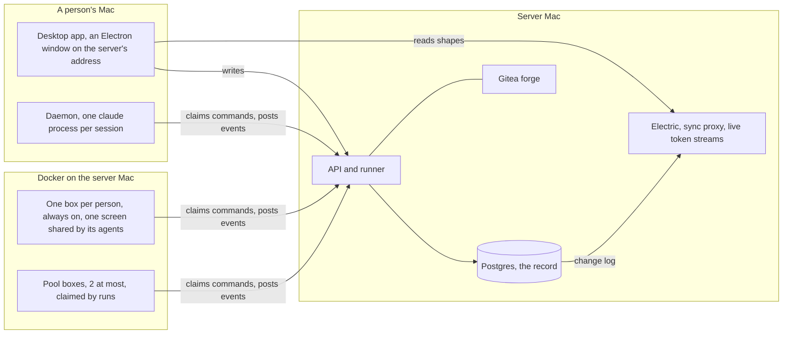
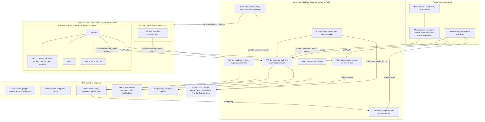

# Target architecture

How every missing feature fits into Agents, decided before building. The goal has three parts, from `docs/intent/multiplayer.md`:

- (A) everything the agent app we studied does, on people's own machines and in the cloud
- (B) the workflow features of the workflow tool we studied
- (C) a team and its agents sharing one record

I wrote this on 2026-10-14 against main at `a553744`, just after the computers and projects branches landed there, and against two branches still landing. A file named with a branch is on that branch, not on main:

- the terminal sessions branch, `.claude/worktrees/agent-ae6bff17618001d52`
- the AWS branch, `.claude/worktrees/agent-a28035877f2a5a41d`

Anything marked new or changed is proposed here and not built. Every row that `docs/intent/feature-checklist.md` marks Partly or Not built has a place in a section below.

I added "Connectors, MCP apps and WebMCP" on 2026-10-15, against main at `bfef3f0`, after Tayler added it to the definition of done. Its decisions are numbered 13 to 20 and its build steps 16 to 22.

## The plan on one page

Most of what Agents lacks comes down to one missing piece. Nothing on the server decides when an agent's turn runs, where it runs, or whether it may run at all. Seven places in the server each write a `message` command straight to a fixed machine, the agent's home or the box a run claimed. So seats, job computers, budgets, agents messaging agents, outside triggers, waking a stopped computer and notifications have nowhere to plug in. The target adds that piece first and builds the rest on it.

1. **Every turn goes through one door.** A person's message, a room, a routine, an outside event, another agent and a pipeline stage each become a row in `turns`, with its source, its agent and who asked. A scheduler on the server checks the budget, picks the place, starts the computer if it is stopped, and only then hands the turn to a machine. A turn that can't run yet waits, and the conversation says why.
2. **Each person keeps one cloud computer, split into seats.** A seat is one agent's display, browser profile, screen stream and folder. Agents on one computer work at once without sharing a screen. A cap sets how many seats a computer holds, and an idle agent's seat goes to the next agent that needs one. Team agents get seats on a team computer.
3. **Parallel coding gets throwaway job computers** from a warm pool, one job each, up to a team limit of 8 by default.
4. **A meter records every turn's usage** by agent, person, source and token type. Budgets are checked before a turn starts, inside it by the engine, and after each usage report.
5. **Agents get tools to message agents, hand them work and create new ones.** Each message is a turn like any other, so it is placed, metered and capped. A chain of agents stops after 4 hops.
6. **Outside events become rows.** GitHub, Slack, email and the rest arrive by polling or over connections the server opens, so nothing gets a public port. Routines and pipelines match them and request turns.
7. **The rest are smaller pieces on the same base.** These are copies and templates with versions, a search page, summaries, notifications, an access panel for each agent, removing a person, more engines, the Mac helper, and connectors with MCP apps and WebMCP.

What stays: Postgres as the one record, the API as the one write path, sync, live tokens, asks, tasks, pipelines, durability and the coding framework. Agents keep thinking inside each engine's own CLI, on the computer where their tools run. That is decision 1, the largest of the twelve below.

The build starts once the current branches land. First comes the door, with waking a stopped computer, since everything else places turns through it. Seats come next, and their screens can be built beside the door. Seats add no spend, since a box already runs its agents' sessions side by side (`daemon/agentsd.ts:450`), and a seat only stops them sharing one screen. Then the meter and budgets, so spend has a ceiling before agent chains and job computers multiply it. Every step ends in something Tayler can try, with a check that fails before it and passes after.

## Today's shape



- Every agent has one home machine, `agents.home_instance_id`. Seven places write a `message` command straight to it or to a run's box: `server/record.ts:357`, `server/session-messages.ts:41`, `server/rooms.ts:127`, `server/routines.ts:40`, `server/runner.ts:117`, `server/runner.ts:739` and `server/refine.ts:402`. No part of the server decides when or where a turn runs.
- An agent thinks on the machine. The daemon runs one `claude -p` per session (`daemon/claude.ts`) and refuses any other engine (`daemon/agentsd.ts:333`).
- Each person has one box, and it never stops, because `stopIdleBoxes` skips any box a person holds (`server/boxes.ts:204-208`). Runs claim pool boxes, 2 at most unless `AGENTS_MAX_BOXES` says more (`server/boxes.ts:32`).
- A box has one display and one browser (`daemon/desktop.ts:51-53`), which all its agents share one action at a time, within 4 GB, 2 CPUs and 4,096 processes (`server/boxes.ts:45-48`).
- Spend is Claude's running total per session, `sessions.cost_usd` (`server/record.ts:74-82`). Runs add theirs up against their pipeline's cap (`server/runner.ts:265`). Nothing splits spend by person or source.
- Routines fire only on cron (`server/runner.ts:1028`). Outside systems start pipelines through `server/hooks.ts`, on the machine port, inside the tailnet.

## The target shape



| Where | What runs there | What it keeps |
|---|---|---|
| A person's Mac | The Agents app, the daemon for agents homed there, terminal capture, and the helper if its owner turns it on | The person's own engine sign-in and terminal transcripts. Only scrubbed events leave it. |
| The server | API, scheduler, meter, runner, connections, the connector gateway, Electric, the sync proxy and the live token streams | Postgres, and each connection's and connector account's secrets in a file of its own, mode 600 |
| A person's cloud computer | One daemon, and a seat for each agent at work, each with a display, a browser and engine sessions | Agents' folders and browser profiles, and the person's engine sign-ins, on a home volume |
| A team computer | The same, for agents the team shares | The same, signed in to the team's account |
| A job computer | One daemon, one seat, one job | Nothing once the job ends |

The record holds every row in the diagram's record box. Who may do what, where a turn runs and what it cost live nowhere else.

## Seats

A seat is one agent's place on a cloud computer: its own display, its own browser and profile, its own screen stream and the agent's folder. Today a box has one of each. It has display `:1`, one browser with its DevTools port on `127.0.0.1:9222` (`daemon/desktop.ts:51-53`), and one Screen view, shared by every session on the box one action at a time (`daemon/screen.ts`).

**Data shape.**

```ts
// seats, new. One row for each seat a computer has.
type Seat = {
  id: SeatId
  team_id: TeamId
  instance_id: InstanceId     // the computer
  n: number                   // 1 to seat_cap. Display :n and DevTools port 9221 + n, so seat 1 keeps :1 and 9222.
  agent_id: AgentId | null    // the agent holding it, or none
  status: 'free' | 'starting' | 'ready' | 'reclaiming'
  held_since: Date | null
  last_turn_at: Date | null   // what the reclaim rule reads
}
// instances, changed. Gains seat_cap, cpus and memory_gib.
// sessions, changed. Gains seat_id.
// screen_takeovers, changed. Gains seat_id.
```

An agent's browser profile and folder belong to the agent, not to the seat. Both live on the computer's home volume under `agents/<agent id>/`, the folder the daemon already makes for each agent (`agentHome` in `daemon/agentsd.ts`). So a reclaimed seat loses its open pages and keeps its logins.

Secrets for one agent live in its seat's own files. A person sets one from the app through a relay that passes the value to the computer without storing it anywhere, the way the screen relay in `server/screens.ts` passes bytes through the API. Today a value can come only from a machine's environment or `~/.agents-app/secrets.json` (`daemon/agentfiles.ts`), so nobody can give a box one from the app.

**Owner.** `server/seats.ts` (new) owns the rows and the reclaim rule. `daemon/seats.ts` (new) starts and stops each seat's Xvnc, window manager, browser and screen service. Today `daemon/desktop.ts` and `daemon/screen.ts` start one of each for the whole box.

**One action.** Alice messages her agent `scout`, which holds no seat. Her computer has 4 seats. Seats 1 to 3 hold agents with running turns, and seat 4 is free.

1. The scheduler marks seat 4 `starting` for `scout` and sends the computer a `seat_open` command.
2. The daemon starts display `:4`, a browser on port 9225 with `scout`'s profile, and a screen service for `:4`. It reports the seat `ready`.
3. The scheduler places the turn. The daemon starts the session with the `computer` MCP server pointed at `:4` and port 9225.
4. Alice opens Screen on `scout`'s page, and the API pairs her with seat 4's tunnel. If she takes over, seats 1 to 3 keep working.

When every seat is held, the scheduler reclaims the seat whose agent has no running or queued turn and no person on its screen, and whose `last_turn_at` is the oldest and more than 15 minutes ago. An archived agent's seat frees at once, once something archives agents. Nothing sets `agents.archived_at` today. When nothing can be reclaimed, the turn waits, and the conversation shows "Waiting for a seat on Alice's computer, 4 of 4 busy".

A Mac has no seats. Its agents run without a screen, as today, until the helper gives it one (see "People's own machines").

**Stays, changes, new.**

- Stays: the image, Xvnc, matchbox, the browser, the screen service, the takeover state machine in `shared/screen.ts` and the `computer` MCP server, all on main since `a553744`. One computer per person, from `addPersonalBox` in `server/boxes.ts`.
- Changes: one display per box becomes one per seat. `daemon/computer-mcp.ts` takes its display and DevTools port from the session's seat. The Screen routes in `server/screens.ts` name an agent's seat. The 24-hour privacy rule reads the sessions that ran on that seat, not on the whole box, so one agent's private task no longer hides its owner's other agents. The box limits of 4 GB and 2 CPUs become the computer's size (decision 2).
- New: the `seats` table, the seat commands, the reclaim rule, the secret relay, archiving an agent, and a seat list on the computer's page.

Team agents work the same way on a team computer, which has `personal` false, is kept for good, and signs in to the team's account.

## Visual work in a conversation

Tayler asked for this on 2026-10-16, and corrected it the same day. The live desktop lives in the agent's panel, and the conversation gets screenshots. While a team talks, an agent works on its own desktop. It might draw a flow diagram of the software under discussion on a whiteboard, or open the team's Jira board in its browser. People watch it live and take over in the agent's panel, on its Computer tab. When the agent wants to show something in the conversation, it posts a screenshot of its desktop there, inline, like any attachment.

**What it needs.**

- The Computer tab in the agent's panel shows a live view of the agent's seat, with Open for full screen, and Watching and Take control. It reuses the screen relay in `server/screens.ts` and the takeover in `shared/screen.ts`.
- `share_screen({ caption? })` in the team-record tools takes a screenshot of the agent's own seat and posts it into the conversation the session serves, as an attachment. `share_file({ path, caption? })` does the same for a file. Both arrive with chat attachments.
- A whiteboard sits on every computer's desktop, in the dock beside the browser and the terminal. It is served inside the box, so a diagram needs no outside account.
- `draw_diagram({ mermaid })` turns a Mermaid description into a whiteboard scene on the agent's screen, so a diagram appears in seconds and people refine it by hand. The agent can still draw with the mouse, as the agent app we studied does in tldraw.
- Any web tool works the same way, since the agent's browser shares its person's logins (decision 3). Once signed in to Jira, any of Alice's agents can open the team's board. People watch it in the panel, and the agent posts a screenshot to the room. A connector gives the agent exact reads and writes underneath.

**Stays, changes, new.**

- Stays: the screen relay, the takeover state machine, each seat's screen, and shared logins.
- New: the Computer tab, `share_screen`, `draw_diagram`, and the whiteboard in the box image. The whiteboard changes `box/` and the packages, which Tayler asked for with the desktop and its dock on 2026-10-16.
- Dropped: a live screen tile inside the conversation, since it repeated the panel.

## A scheduler places every turn

**Data shape.** The `turns` table exists for room turns (`server/migrations/0001_data_model.sql`, used by `server/rooms.ts`). It becomes the queue for every turn.

```ts
// turns, changed. Every turn an agent is asked to take, not only a room's.
type Turn = {
  id: TurnId
  team_id: TeamId
  agent_id: AgentId
  source: 'person' | 'room' | 'routine' | 'trigger' | 'agent' | 'delegation' | 'pipeline' | 'system' | 'call'
  lane: 'user' | 'agent' | 'background'   // within one agent, user goes first
  conversation_id: ConversationId | null  // exactly one of these three is set
  task_id: TaskId | null
  run_id: RunId | null
  session_id: SessionId | null            // set when the turn is placed
  asked_by_person: PersonId | null
  asked_by_session: SessionId | null      // the agent session that asked, for agent and delegation turns
  chain_id: TurnId                        // the first turn of an agent-to-agent chain, or this turn
  hops: number
  account: PersonId | 'team'              // whose engine sign-in pays
  status: 'queued' | 'waiting' | 'placed' | 'running' | 'done' | 'failed' | 'cancelled'
  wait: 'computer_starting' | 'seat' | 'budget' | 'account_limit' | 'engine' | 'machine_offline' | null
  instance_id: InstanceId | null
  seat_id: SeatId | null
  requested_at: Date
  placed_at: Date | null
  started_at: Date | null                 // exists
  finished_at: Date | null                // exists
  deadline: Date | null                   // exists, for rooms
  outcome: 'sent' | 'pass' | 'skipped' | 'timeout' | 'cancelled' | 'error' | null  // exists, for rooms
}
```

The lifecycle is one transition table in `shared/turns.ts` (new), as the message lifecycle is in `shared/lifecycle.ts`, so no path can move a turn backward.

**Owner.** `server/scheduler.ts` (new) runs in the runner's loop, which ticks every 2 seconds and wakes on `pg_notify` (`server/runner.ts:38-39`). The seven call sites in "Today's shape" call `requestTurn` instead of writing a command, and only the scheduler writes `message` commands.

**Where a turn goes, in this order.**

1. A session that has run before stays on its computer, since the engine's transcript, which resume needs, lives there.
2. A pipeline stage goes where its run's workspace is. That is a job computer, or the agent's computer when the pipeline says `runsOn: 'home'` (`shared/pipeline.ts:198`).
3. One attempt of a task that has several goes to a job computer.
4. Anything else goes to the agent's seat on its computer, which is its owner's computer, a team computer or a Mac.

A turn waits, with its reason, while its computer starts, while no seat is free, while its agent's engine is missing there, while a budget it falls under is spent, while its account is at its plan's limit, or while its Mac is offline. Within one agent, the user lane goes before the agent lane, and both go before background, the order the agent app we studied gives each agent's queue (`docs/evidence/box/box-agent-loop.md` 2.3). One session runs one turn at a time, which the daemon already enforces (`daemon/agentsd.ts:452`). Several sessions of one agent can run at once on its seat, as they do on a box today.

**One action.** `scout`'s 9:00 routine fires while Alice's computer is stopped.

1. `server/routines.ts` writes the routine's post and calls `requestTurn` with source `routine` and lane `background`.
2. The scheduler finds the computer stopped. It marks the turn `waiting` with `computer_starting` and starts the container (`startClaimedBoxes` in `server/boxes.ts`).
3. The daemon reports its desktop up. The scheduler opens `scout`'s seat and writes the `message` command, with the budget left as `maxBudgetUsd`.
4. The daemon claims the command, and durability keeps it claimed until the turn ends (`server/durability.ts`).
5. The turn's usage event arrives. The meter writes its row, and the turn is `done`.
6. A turn running with no new event for 10 minutes is marked stuck, and the people who asked for it get a notification. Nothing is stopped.

**Stays, changes, new.**

- Stays: commands, claims and durability. Rooms keep taking one turn at a time, with deadlines (`server/rooms.ts`). Runs keep claiming their machine (`server/runner.ts:357`).
- Changes: `agents.home_instance_id` names the agent's computer and no longer decides alone where a turn runs. People's own computers stop when idle and start on a turn, as Tayler decided on 2026-10-14. Nothing does that yet.
- New: `server/scheduler.ts`, `shared/turns.ts`, wait reasons in conversations, the stuck check, and a run history for routines, since every firing is now a turn row. Today a routine keeps only `last_fired_at`.

## Agents creating, messaging and delegating to agents

Today agents work together only in rooms (`server/rooms.ts`). An engine's own subagents land in the record under the call that started them (`events.parent_tool_use_id`). The team-record tools can't reach another agent. `daemon/record-mcp.ts` registers `search_record`, `read_session`, `ready_tasks`, `recent_activity`, `pipeline_history`, `update_memory`, `agent_profile` and `log_decision`, which read and remember. `createAgent` is reachable only by a person (`server/agents.ts`). `sessions.started_by_session` is in the schema, and nothing sets it.

**Data shape.**

```ts
// conversations.kind, changed. Gains 'agents', a thread between two agents that the team can read.
// messages, exists. Holds speaker 'agent', agent_id, and quoted_message_id for a reply.
// events, changed. Gains author_agent, the agent that wrote a user event into another agent's session.
// turns, changed, as above. Source 'agent' or 'delegation', with asked_by_session, chain_id and hops.
// tasks, changed. Gains asked_by_session, the session that handed the task over.
// sessions.started_by_session, exists. Now set on a delegated task's session.
// agents, changed. Gains made_by_session, and accepts, which "Permissions" describes.
type TeamAgentLimits = {    // team settings, new
  hops: number              // 4. A chain of agent turns stops here.
  chain_usd: number         // 2. Spend for one chain, across every agent in it.
  agents_per_person: number // 12. How many agents agents may create for one person.
}
```

**Owner.** A second MCP server beside `team-record`, `daemon/team-agents-mcp.ts` (new). Its tools are `list_agents`, `send_to_agent`, `delegate_task`, `check_task`, `report_back`, `ask_people` and `create_agent`. `delegate_task` starts a task or a pipeline run for another agent. `ask_people` raises a `question` or `form` ask, kinds the `asks` table lists and nothing creates today. The API checks each call as the session making it, the way `server/teamrecord.ts` checks reads. The daemon allows these tools without asking, except `create_agent` (`allowedTools` in `daemon/agentsd.ts`), so the engine asks a person before every create through the usual ask card. The API also refuses a create with no answered ask behind it, so an engine that runs without asking can't skip the person.

**One action.** In Alice's DM, `scout` asks `writer` for a draft.

1. `scout` calls `send_to_agent` with `to: "writer"` and the text.
2. The API checks that `writer` takes messages from agents of `scout`'s owner (decision 7), and that the chain is under 4 hops and $2.
3. It writes the message into the thread between `scout` and `writer`, a user event in `writer`'s session for that thread with `author_agent` set, and a turn with source `agent`, lane `agent`, the chain of `scout`'s turn and one more hop. The tool returns at once.
4. The scheduler places `writer`'s turn on `writer`'s seat, on its owner's account.
5. `writer`'s reply goes into the thread. A turn with source `agent` goes back to the session that sent the message, which is `scout`'s session in Alice's DM, quoting the reply. So `scout` carries on where it started.
6. Both turns show under source `agent` on the meter, and the thread shows in the sidebar.

A task already reports each turn to the conversation it came from (`reportToConversation`, `server/tasks.ts:59`). A delegated task reports to the session that handed it over instead, as a `delegation` turn, when its agent calls `report_back` or a person marks it done.

**Stays, changes, new.**

- Stays: rooms, engine subagents, and tasks reporting back.
- Changes: the daemon adds the new server to each session's MCP config next to `team-record` (`mcpConfig` in `daemon/agentsd.ts`), except a judge's, which gets neither. Rooms get a member cap, and agents can be added after a room is made, which today only people can (`server/onboarding-routes.ts:59`).
- New: the tools, the `agents` thread, chain limits, `author_agent`, the ask before a create, and a list of a session's subagents in its panel, read from `parent_tool_use_id`.

## The usage meter and budgets

Today each session keeps Claude's running total in `sessions.cost_usd` (`server/record.ts:74-82`). Each run adds up its sessions (`server/runner.ts:265`) and stops at its pipeline's cap, and each stage's session gets `--max-budget-usd` (`daemon/claude.ts:215`, set from `server/runner.ts:480`). No budget covers a chat, a room or a routine. The session status `limited` exists (`shared/types.ts:10`), and nothing sets it.

On a Claude subscription the dollars are what the engine says the tokens would cost, not a bill. Each account's real ceiling is its plan's limit, which plays the part of the weekly pool in the agent app we studied. The meter shows both: dollars and tokens to compare agents, and an account's plan limit when the engine reports it.

**Data shape.**

```ts
// usage, new. One row for each turn that ended, written in the transaction that records its usage event.
type Usage = {
  id: UsageId
  team_id: TeamId
  turn_id: TurnId | null                 // null for a terminal session, which nothing places
  session_id: SessionId
  agent_id: AgentId | null
  account: PersonId | 'team'             // whose engine sign-in paid
  asked_by: PersonId | null              // for spend by person
  source: Turn['source'] | 'terminal'
  engine: 'claude' | 'codex' | 'gemini'
  model: string
  input_tokens: number
  output_tokens: number
  cache_read_tokens: number
  cache_write_tokens: number
  other_tokens: Record<string, number>   // kinds one engine has, such as reasoning
  usd: number                            // this turn's share, the session's running total minus its last
  at: Date
}
// budgets, new
type Budget = {
  id: BudgetId
  team_id: TeamId
  scope: { team: TeamId } | { person: PersonId } | { agent: AgentId } | { routine: RoutineId }
  period: 'day' | 'week'
  usd: number
  warn_at: number                        // 0.8 sends a notification at 80%
  set_by: PersonId
}
// spend, new. A running sum for each budget and period, updated with each usage row.
```

**Owner.** `server/meter.ts` (new). `appendEvents` in `server/record.ts` calls it where it updates `sessions.cost_usd` today.

**Where caps are enforced.**

| Where | What it stops | File |
|---|---|---|
| Before a turn is placed | A turn whose agent, person, routine or team budget is spent waits with `wait: budget`, and an ask goes to whoever may raise it | `server/scheduler.ts`, new |
| Inside the turn | The engine stops itself at the smallest budget left, passed as `maxBudgetUsd` | `daemon/claude.ts:215`, exists. New for each other engine. |
| After each usage event | A budget crossed while several sessions spend at once interrupts every running session in its scope, through the `interrupt` command that exists | `server/meter.ts`, new |
| Agent chains | A send past the chain's hops or spend is refused | the agent tools' route in `server/api.ts`, new |
| Pipeline runs | A run stops at its pipeline's cap. The coding framework's policy caps a run at $25 and 180 minutes. | `server/runner.ts`, exists. `ops/policies/agents.json`, exists. |
| The account's plan | A rate-limit result sets the session `limited`. The account's turns wait with `account_limit` until the limit resets, then go. | `daemon/claude.ts`, changed. `server/scheduler.ts`, new. |

**One action.** `scout` has a weekly budget of $5, and it has spent $4.20.

1. A turn is requested. The scheduler reads `spend` for that budget, finds $0.80 left, and places the turn with `maxBudgetUsd` 0.80.
2. The turn ends at $0.55. The meter writes the usage row, `spend` reaches $4.75, past 80%, and Alice gets a notification.
3. The next turn has $0.25 left. The engine stops it at its cap, and the result lands in the record.
4. The turn after waits with `wait: budget`. Alice raises the budget from the ask, and the turn is placed.

**The page.** A Usage page reads `usage` through an Electric shape, like every other list, so it is live as turns end. It shows the week by agent, by person, by source and by token type. Each budget is a flat neutral track with flat segments named in a legend. The sources group the way the agent app we studied groups them: people, routines and triggers, agents, rooms, plus pipelines, system and terminals.

**Stays, changes, new.**

- Stays: run caps and the framework's policy caps.
- Changes: `sessions.cost_usd` stays the engine's running total, and the meter takes each turn's share from it.
- New: `usage`, `budgets`, `spend`, the page, and the `limited` status set from the engine's rate-limit result.

## Cloud scale and hosting

Today one Docker, colima on the server Mac, runs every box, since `server/boxes.ts` calls the local `docker`. The AWS branch writes a stack with one server and one box host, an `m7g.xlarge` the server reaches over Tailscale SSH, at about $217 a month (`docs/aws.md` there). Pool boxes keep home volumes between runs, and there are 2 at most.

**Data shape.**

```ts
// hosts, new. A machine that runs cloud computers.
type Host = {
  id: HostId
  name: string                    // 'server-mac', 'home-box', 'agents-boxes'
  where: 'this_mac' | 'home' | 'aws'
  docker: string                  // a Docker endpoint, such as ssh://agents-boxes over Tailscale SSH
  role: 'people' | 'jobs' | 'both'
  cpus: number                    // what the computers on it may add up to
  memory_gib: number
  status: 'online' | 'draining' | 'offline'
}
// instances, changed. Gains host_id and ephemeral, beside seat_cap, cpus and memory_gib from "Seats".
// warm_pools, new. For each team, how many job computers to keep started, and from which image.
// job_images, new. For each repo, an image with its dependencies installed, rebuilt when a lockfile changes.
```

**Owner.** `server/hosts.ts` (new) picks a host with room for each new computer and holds its Docker endpoint. `server/boxes.ts` keeps starting and stopping containers, on the chosen host's Docker instead of the local one.

**Three kinds of cloud computer.**

| Kind | Holds | Account | Lives |
|---|---|---|---|
| A person's own computer | that person's agents, in seats | the person's own sign-in | for good, stopped when idle and started on a turn |
| A team computer | agents the team shares, in seats | the team's sign-in | for good, with the same idle rule |
| A job computer | one job, which is a pipeline run or one attempt at a task | decision 5 | removed after the job |

**One action.** Tayler starts a task with three attempts.

1. The scheduler asks `server/hosts.ts` for three job computers.
2. The team's warm pool has two started on the jobs host, with their desktops up and the repo's job image. Each is claimed in one row update, as `claimBox` claims a pool box today. The third starts from the image.
3. Each gets a workspace, with a worktree for each repo from a cache on the host, and the attempt's first turn.
4. Once an attempt's work is pushed to its own branch and nobody has spoken to it for 2 hours, its computer is removed. The pool starts a fresh one.

**Scale, from measured numbers.** Measured for `docs/design/computers.md`, a box's desktop and browser took 323 to 496 MiB idle and 564 to 651 MiB while an agent drove the screen. With three browser engines running checks it took up to 1.7 GB. Claude Code is in none of these numbers, since nobody measured it. The AWS branch's `docs/aws.md` plans about 1 vCPU and 2 to 3 GiB for each working box, four on an `m7g.xlarge` ($119 a month) and eight on an `m7g.2xlarge` ($238). By that rule, eight job computers at once take one `m7g.2xlarge` as a jobs host, apart from the people host, so a burst of jobs never starves a person's seats.

**A home server** is a host like the AWS one. It joins the tailnet and runs Docker, and the server reaches it over Tailscale SSH. Its computers reach the server's machine port over the tailnet, while AWS computers reach it over the VPC, as Tayler decided on 2026-10-14. The firewall rules stay the same everywhere. A computer reaches the open web and the server's machine port, and nothing private (`ops/box-firewall.sh` on main, `ops/aws/box-firewall.ts` on the AWS branch).

**Stays, changes, new.**

- Stays: containers, home volumes for people's and team computers, the box firewall and the AWS stack.
- Changes: runs move from pool boxes with volumes to job computers without them. Pool boxes become team computers, which a person can still claim. `AGENTS_MAX_BOXES` becomes a job limit for each team, 8 by default, under each host's room. Every `docker` call goes to a host.
- New: `hosts`, the warm pool, job images, and a view of what each host runs.

## Routines, triggers and integrations

Today a routine is a prompt with a trigger (`routines` table), and only `cron` fires (`server/runner.ts:1028`). It posts to the agent's main conversation (`server/routines.ts`). The schema also allows `webhook`, `github`, `linear`, `slack` and `email` triggers, which nothing fires. Pipelines start from forge issues, their own signed webhook, cron or a person (`shared/pipeline.ts:12-17`, `server/hooks.ts`). GitHub can't reach the tailnet, so `server/github-worker.ts` polls GitHub for labels and pull request state, every 60 seconds by default (`server/github-worker.ts:30`). `conversations.kind` allows `pr` and `slack_thread`, and `asks.kind` allows `draft`, and nothing uses them.

**Data shape.**

```ts
// connections, new. One outside account the team connected.
type Connection = {
  id: ConnectionId
  team_id: TeamId
  kind: 'github' | 'slack' | 'email' | 'linear' | 'sentry' | 'pagerduty'
  account: string                 // the workspace, org or address, for people to read
  secret_names: string[]          // values live in the server's secret files, never in Postgres
  how: 'poll' | 'socket' | 'relay'
  read_to: string | null          // how far a poll has read
  added_by: PersonId
  status: 'ok' | 'failing' | 'off'
}
// inbound_events, new. One outside event, kept once.
type Inbound = {
  id: InboundId
  team_id: TeamId
  connection_id: ConnectionId
  kind: string                    // such as 'github.issue.labeled', 'slack.mention', 'email.received'
  external_id: string             // unique per connection, so an event read twice is one row
  payload: unknown                // scrubbed, and given to agents as quoted data, never as instructions
  matched: { routine_ids: string[]; run_ids: string[] }
  received_at: Date
}
// routines, changed. trigger gains 'sentry', 'pagerduty' and 'group'. Gains person_id, whose account a
// firing runs on, and does, which is 'post' to the main conversation or 'task' to start a task.
// people, changed. Gains slack_user_id, so a teammate's Slack message counts as theirs.
```

**Owner.** `server/triggers.ts` (new) matches inbound events to routines and pipelines. One file per service under `server/connections/` (new) talks to that service, the way `server/forge.ts` is the only file that talks to the forge. The runner's loop polls each connection, as it fires cron today.

**How events get in with no public port.** GitHub, Linear, Sentry and PagerDuty are polled through their APIs. Slack's Socket Mode delivers events over a connection the server opens, so Slack needs no inbound port. Email is read from a mailbox by polling. A relay outside the tailnet is only for a source that can do nothing but push (decision 8).

**One action.** A teammate labels a GitHub issue `agent:fix`.

1. The GitHub poller sees the label and writes an `inbound_events` row, once, keyed by the event's id.
2. `server/triggers.ts` finds the bug-fix pipeline's trigger and `scout`'s routine "triage labeled issues". It starts the run, as `server/hooks.ts` does for the forge, and requests a turn with source `trigger` for the routine.
3. The run's stages go to a job computer, and the routine's turn goes to `scout`'s seat.
4. `scout` drafts a note for the team's Slack channel, which is an ask of kind `draft`. Alice approves it, and the Slack connection posts it.
5. The thread it starts is a `slack_thread` conversation, so a teammate who answers in Slack reaches `scout` as a person, matched by `slack_user_id`.

**Team agents in Slack.** The team installs one Slack app. Teammates mention an agent by name in a channel, or message the app directly. Each Slack thread is a `slack_thread` conversation, and its turns run on the agent's owner's account under decision 7's rules.

**Email.** An agent can get an address on a domain the team owns, read by polling. Mail to it is an inbound event. Replies go out as `draft` asks, unless the agent's access lets it send.

**Pull requests.** Each pull request an agent opens gets a `pr` conversation, where reviewers and its agent talk. CI results and review comments, read by the GitHub poller, become turns for the task's agent with source `trigger`.

**Hosted connectors.** Their sign-in, tokens and tools are designed in "Connectors, MCP apps and WebMCP". Slack's events connection above and the Slack connector there share one Slack app.

**Stays, changes, new.**

- Stays: cron routines, pipeline webhooks, and their one run per event (`runs` unique on `trigger_payload->>'once'`).
- Changes: routines request turns through the scheduler and can start a task. A routine whose person hasn't opened the app for 7 days pauses and says so, as the agent app we studied does to avoid wasted spend.
- New: connections, pollers, the Slack app, mailboxes, inbound events, `pr` conversations, and sending drafts.

## Templates, sharing and cloning

Today a person saves an agent as a team template, and a new agent can start from it (`saveTemplate` and `install` in `server/agents.ts`, "Save as template" and "Start from" in `app/src/AgentPage.tsx`). The recipe holds title, role, instructions, model, skills, plugins and cron routines. Saving again overwrites the recipe and adds one to `version`, so the old version is gone. An agent doesn't record which template it came from. `agents.avatar`, `agents.visibility` and `agent_managers` exist in the schema, and nothing reads them.

**Data shape.**

```ts
// templates, exists. team_id, name, version, recipe, share_slug, visibility.
// template_versions, new. Every saved recipe, kept.
type TemplateVersion = { template_id: TemplateId; version: number; recipe: Recipe; saved_by: PersonId; saved_at: Date }
type Recipe = {                                   // changed. Today's fields, then the new ones.
  title: string | null
  role: string | null
  instructions: string
  model: string | null
  skills: { name: string; description: string; content: string }[]
  plugins: { name: string; kind: 'stdio' | 'http'; config: unknown }[]   // secret names only, as today
  routines: { name: string; prompt: string; trigger: string; trigger_config: unknown }[]
  engine: 'claude' | 'codex' | 'gemini'           // new
  hooks: unknown                                  // new. The engine's hook settings.
  avatar: unknown                                 // new. agents.avatar, which nothing uses yet.
  memories: { kind: 'profile' | 'log'; content: string }[]  // new. Team scope only, picked by the person.
  documents: { path: string; content: string }[]  // new. Reference files the agent should know.
  getting_started: string | null                  // new. A skill to run on the first message.
}
// agents, changed. Gains template_version_id, where it came from.
```

**Owner.** `server/agents.ts`, which owns an agent's setup today.

**One action.** Bob copies Alice's agent `release-notes`.

1. Bob presses Copy on its page and picks "with the team's memories".
2. The server saves the recipe as a new template version. It creates `release-notes-bob`, owned by Bob, on Bob's computer, with `template_version_id` set. Memories about one person and secret values never copy.
3. Bob's first message places a turn on a seat on Bob's computer. If a plugin needs a secret Bob's computer lacks, the session stops and says which, as `daemon/agentfiles.ts` does today.

**Moving setups in and out.** Export writes the recipe as a JSON file, and import reads it with the same zod schema, so a recipe can leave the team as a file (decision 11). The daemon on a Mac can also offer a person's own Claude Code skills and instructions as a recipe, which covers reading a person's setup into an agent. A person's memory fact can be promoted to the team's from the agent's Memory list, so a copy can carry it. Memory also gains recall and sort tools beside `update_memory` in `daemon/record-mcp.ts`, which the checklist lists as missing.

**Hooks** ride in the recipe and become the engine's settings in the session folder. For Claude, `daemon/agentfiles.ts` writes them to `.claude/settings.local.json` beside the skills it writes now. The daemon already starts Claude with `--setting-sources project,local` (`daemon/claude.ts:205-207`), so Claude reads them.

**Stays, changes, new.**

- Stays: saving, starting from a template, and templates staying inside the team.
- Changes: versions are kept, and the recipe gains fields.
- New: copying an agent, export and import, provenance, hooks, and promoting a memory to the team.

## People's own machines

Today a Mac runs the same daemon as a box (`daemon/agentsd.ts`), and agents can live there. Commands on a Mac ask first (`server/permissions.ts`). The desktop app is an Electron window on the server's tailnet address (`desktop/main.cjs`). On the terminal sessions branch, a person connects a folder with `daemon/folders.ts`, and `daemon/transcripts.ts` reads Claude Code's transcripts for sessions started there into the record (`server/migrations/0013_local_sessions.sql` there, with `connected_folders`, `sessions.folder_id` and `sessions.cwd`). The Mac computer-use helper is a design only, in `docs/design/computers.md`. `approval_rules.instance_id` exists, and no tool uses it.

**Data shape.**

```ts
// instances kind 'mac', exists, with owner_id.
// connected_folders and sessions.folder_id, exist on the terminal sessions branch.
// mac_grants, new. What a person lets agents do on their Mac.
type MacGrant = {
  instance_id: InstanceId
  agent_id: AgentId
  tools: ('shell' | 'read' | 'copy' | 'screen')[]
  apps: string[]            // bundle ids the helper may capture and drive, for 'screen'
  granted_by: PersonId      // always the Mac's owner
  granted_at: Date
}
// commands.kind, changed. Gains 'mac_tool', a cloud agent's request that the Mac's daemon runs after an ask.
```

**Owner.** The Mac's daemon, bundled into the one signed download that Tayler decided on 2026-10-14. The helper is a separate signed app that the daemon talks to over a Unix socket, as its design says.

**Three ways a Mac takes part.**

1. **Agents whose home is the Mac.** The scheduler places their turns there when the Mac is online, and their commands keep asking, as decided.
2. **The person's own terminal sessions.** They land in the record and are never placed, since the person drives them. The meter shows them under source `terminal` once the daemon reads the cost lines Claude Code writes, which the branch lists as not done. The same branch lists Codex sessions, telling a closed terminal from a running one, and listing connected folders in the app as not done. They take a second transcript reader, a read of `~/.claude/sessions`, and one more view.
3. **A cloud agent using the Mac.** A tool in the cloud session (`mac_shell`, `mac_read`, `mac_copy` or `mac_screen`) sends a `mac_tool` command. The Mac runs it only after its owner answers the ask, and its daemon checks that the answer came from the owner, not a teammate. Screen use goes through the helper, which captures only the owner's listed apps, never types into a secure field, and gives the screen back the moment the real mouse moves.

**One action.** `qa`, on Alice's cloud computer, needs Alice's iOS simulator.

1. `qa` calls `mac_screen` with `app: "Simulator"`.
2. An ask reaches Alice on her desktop: "qa wants to use Simulator on your Mac for this session". There is no "always".
3. Alice allows it. The API sends `mac_tool` to her Mac, and the daemon starts the helper, which captures only Simulator's windows.
4. Screenshots and actions flow back through the daemon, each one an event in `qa`'s session.

**Joining.** The definition of done asks for invite to first message in under 10 minutes. That needs the signed download and a new person's computer starting with its first seat ready. Step 1's check times the second part.

**Stays, changes, new.**

- Stays: the daemon on Macs, terminal capture and durability.
- Changes: the desktop app becomes one signed download with the daemon inside, decided to start after the current branches land.
- New: `mac_grants`, `mac_tool`, the helper, and a Codex transcript reader. The helper is Swift, and a file in another language lands only on the allowlist in `ops/policies/agents.json`, a protected file, so adding it needs Tayler.

## The workflow tool's features not yet built

From the data model doc's section on the workflow tool we studied, `docs/design/workflow.md` and table B of `docs/intent/feature-checklist.md`. Already built are drafts, ready and held work, blocks, tasks over several repos, the Changes list and file viewer, pull requests from a task, writing without asking inside a workspace, the research, plan and implement pipeline, pinned comments, the palette, documents versioned from the task folder, asks, a worktree per repo, the session states, one write path, sync shapes and live tokens.

| Feature | Why it counts as missing | Data shape | Owner |
|---|---|---|---|
| A board of tasks by phase | `tasks.phase` exists, and nothing reads or writes it | `tasks.phase` holds the stage of its pipeline, or a column a person picks | `server/tasks.ts`, `app/src/Board.tsx` (new) |
| Parallel attempts with a compare view | `server/launch.ts` makes one workspace per task, on the agent's home machine | `tasks.attempts`, `workspaces.attempt`, `tasks.picked_workspace_id` | `server/launch.ts`, the scheduler, `app/src/Compare.tsx` (new) |
| Forking a session from a step | `sessions.started_by_session` is never set | `sessions.forked_from_seq`. Claude Code resumes as a fork with `--fork-session`. | `server/tasks.ts`, `daemon/claude.ts` |
| Earlier states of a file, as checkpoints | "Changes are current state only" (`docs/design/workflow.md`) | `file_snapshots`, new, with workspace, path, turn and blob | `daemon/changes.ts`, `server/changes.ts` |
| People on a task, with roles | `task_members` is read in `server/access.ts` and `server/order.ts`, and nothing writes it | the existing table, with edit or comment | `server/tasks.ts` |
| Watching CI and review comments, and fixing them | `server/forge.ts` posts commit statuses and never reads CI | inbound events from the GitHub poller | `server/triggers.ts` |
| A pull request's state after a merge by hand | `docs/design/workflow.md`, "Not done" | `artifacts.state`, set by polling | the GitHub connection |
| Workers on many hosts | one Docker on the server Mac | `hosts` | `server/hosts.ts` |
| The research, plan and implement pipeline run for real | it has run only with the stand-in for Claude, and needs an agent named `builder` on a box | none | a `builder` agent on a team computer, its stages on job computers |

**One action, parallel attempts.** Tayler starts "add dark mode" with 3 attempts.

1. `server/launch.ts` makes three workspaces, with `attempt` 1 to 3, and requests three turns that need job computers.
2. Each attempt runs on its own job computer and pushes to `task/<slug>-<n>`.
3. The Compare view shows the three diffs side by side, each with its checks and screenshots.
4. Tayler picks attempt 2. Its branch opens the pull request through `server/pulls.ts`. The other two are discarded, and their computers are removed.

**Stays, changes, new.** Everything in the built list stays. `server/launch.ts` changes to make several workspaces, and the rest of the table is new.

## Multiplayer gaps

Four parts, each a small design of its own. The composer's pickers, menus, attachments and dictation are app work for the new design system. They change the architecture in one place. Attachments are files a person sends, stored in the `blobs` table that holds images today (`server/migrations/0008_computers.sql:31`).

### Search for people

Agents search the record with Postgres full-text search (`server/teamrecord.ts`). People have only the palette, which matches names and titles (`app/src/Palette.tsx`).

- **Data shape.** No new table. `GET /v1/search` (new) takes words and filters for agent, person, kind, folder and dates. It runs the same query as `search_record` with the person's access from `server/access.ts`.
- **Owner.** `server/teamrecord.ts`, which holds the query, and `app/src/Search.tsx` (new).
- **One action.** Tayler searches "flaky webhook". Events and messages come back newest first, and each opens its session at that step.
- **Stays, changes, new.** The query and the access rules stay. The route and the page are new.

### Summaries

- **Data shape.**

```ts
// summaries, new
type Summary = {
  id: SummaryId
  team_id: TeamId
  of: { session_id: SessionId } | { agent_id: AgentId; day: string } | { team_day: string } | { task_id: TaskId }
  from_seq: number | null      // for a session, the steps it covers
  to_seq: number | null
  text: string                 // each sentence links the steps it rests on
  model: string
  turn_id: TurnId              // the turn that wrote it, metered with source 'system'
  written_at: Date
}
```

- **Owner.** `server/summaries.ts` (new), run by the runner. Its turns run on a team computer on the team's account, under a team budget for summaries.
- **One action.** A session goes idle with new steps since its last summary. A cheap model writes a summary of those steps, and a sentence that cites no step is dropped, the rule coach already applies to its findings (`server/evidence.ts`). Each agent's day and the team's day get one each night.
- **Stays, changes, new.** All new. Runs keep their stage summaries.

### Notifications

- **Data shape.**

```ts
// notifications, new
type Notification = {
  id: NotificationId
  team_id: TeamId
  person_id: PersonId
  kind: 'ask' | 'stuck' | 'finished' | 'failed' | 'budget' | 'mention' | 'sign_in'
  subject: { ask_id: AskId } | { turn_id: TurnId } | { budget_id: BudgetId } | { message_id: MessageId } | { login_id: LoginId }
  created_at: Date
  read_at: Date | null
  sent: { desktop?: Date; slack?: Date; email?: Date }
}
// people, changed. Gains notify: for each kind, which of desktop, Slack and email.
```

- **Owner.** `server/notify.ts` (new). It is called by `openAsk` in `server/record.ts` for an approval, by the scheduler for stuck, finished and failed turns, by the meter for budgets, and by messages that mention a person. The runner also notifies a person a week before their engine sign-in runs out, from `claude_logins.valid_until`, as Tayler decided on 2026-10-14. Today the Box page shows that date (`app/src/Box.tsx:184`), and nothing warns.
- **One action.** An approval card opens in a room. Each person who may answer it gets a row. The desktop app reads a `notifications` shape and shows a system notification while its window is in the background. A person who hasn't read it in 5 minutes gets a Slack message (decision 9).
- **Stays, changes, new.** Ask cards stay. Everything else is new.

### Permissions

- **Data shape.**

```ts
// agent_access, changed from agent_managers, which nothing uses. Who may do what with an agent.
type AgentAccess = { agent_id: AgentId; person_id: PersonId | null; role: 'manager' | 'user' }  // null is the whole team
// agents, changed. Gains accepts.
type Accepts = { people: 'owner' | 'listed' | 'team'; agents: 'owner' | 'team' }
// team_policy, new. Limits an admin sets, which only narrow, such as "agents never send email without asking".
// approval_rules, exists. Standing allows and denies for each tool, agent and machine.
```

| Action | Owner | Manager | User | Others on the team |
|---|---|---|---|---|
| See its sessions, unless they are private | yes | yes | yes | yes |
| Message it, add it to a room, start a task with it | yes | yes | yes | when `accepts.people` is `team` |
| Take over its screen | yes | yes | no | no |
| Change its setup or its budget | yes | yes | no | no |
| Answer its asks | yes | yes | yes | yes, when they can see the conversation, as today. Only a Mac's owner answers a `mac_tool` ask. |

- **Owner.** `server/access.ts` gains `canDrive(person, agent, action)`, and every route that requests a turn calls it. The agent page gets an access panel.
- **One action.** Bob messages Alice's agent `scout`, which lives on Alice's own computer. Its `accepts.people` is `owner` by default, so the API refuses with "Only Alice drives scout. Ask her to open it to the team."
- **What agents may do without asking** stays in three places: the session's permissions (`server/permissions.ts`), standing rules (`approval_rules`), and the team policy, which only narrows. The access panel shows all three. Commands in a cloud computer run without asking, as Tayler decided on 2026-10-14. `server/permissions.ts` still asks on a box.
- **Stays, changes, new.** The owner check in `createAgent` stays (`server/agents.ts`). `agent_managers` becomes `agent_access`. Today any teammate can edit any agent, and can message, room or task an agent on someone's own computer, since nothing in `server/record.ts`, `server/tasks.ts` or `server/rooms.ts` checks. Enforcing Tayler's 2026-10-14 call that only the owner drives agents on their own box is new.

### Removing a person

- **Data shape.**

```ts
// removals, new. One row per removal, with each step's result, so a removal that stops part way resumes.
type Removal = {
  id: RemovalId
  team_id: TeamId
  person_id: PersonId
  requested_by: PersonId
  agents: 'transfer' | 'archive'
  transfer_to: PersonId | null
  steps: Record<'export' | 'tailnet' | 'computer' | 'private_work' | 'memories' | 'terminal' | 'agents' | 'authorship', 'done' | 'failed' | 'todo'>
  finished_at: Date | null
}
// people, changed. Gains removed_at. The row stays, so shared messages keep an author to name.
```

- **Owner.** `server/removal.ts` (new), and a Remove button on the Team page for admins.
- **One action.** An admin removes Sam. The server exports what the admin may see, which leaves out private rooms, since Tayler decided admins stay out of them. It removes Sam from the tailnet, which `server/tailscale.ts` already does for a tailnet user, and stops and deletes Sam's computer with its volume, which takes Sam's Claude sign-in with it. It deletes Sam's private conversations, tasks and terminal sessions, and every memory about Sam. It transfers or archives Sam's agents, and names Sam's shared messages as from a removed person (decision 10).
- **Stays, changes, new.** All new, except the tailnet removal.

## Other engines

Today the harness interface in `daemon/harness.ts` has one implementation, Claude (`daemon/claude.ts`), and the daemon refuses any other (`daemon/agentsd.ts:333`). `agents.harness` allows `claude` and `codex`, and `createAgent` takes no engine. `instances.harnesses` exists and is synced (`server/sync.ts:54`), and no daemon reports it.

**Data shape.**

```ts
// agents.harness, changed. Gains 'gemini'. agents.model and agents.effort exist.
// instances.harnesses, exists. Each daemon's heartbeat now reports the engines it has, with versions.
// engine_logins, changed from claude_logins. One sign-in for each engine on each computer.
// HarnessStart, changed. oauthToken becomes a credential for the engine. maxBudgetUsd stays optional.
```

**Owner.** One file per engine beside `daemon/claude.ts`, such as `daemon/codex.ts` and `daemon/gemini.ts` (new). Each turns the engine's own output into the same `EventBatch` kinds (user, assistant, thinking, tool_call, tool_result, ask, usage, error), so the record, the meter and the app don't change. `daemon/agentfiles.ts` writes skills and hooks in each engine's own layout.

**What an engine must do before agents can pick it.**

1. Pass the five crash tests in `docs/design/durability.md`, as decided on 2026-10-13.
2. Report usage for each turn. Without it the meter can't stop a turn from inside and can only interrupt it after.
3. Ask before a tool runs, or run only where commands run without asking. That is a cloud computer, by Tayler's 2026-10-14 call, never a Mac.

What the CLIs on this Mac offer, from their help. `codex exec --json` prints events as JSON lines, and `codex exec resume` continues a session. `exec` can't stop to ask a person, and runs under a sandbox mode instead. Codex's app server, marked experimental, is the route to asking. The Gemini CLI isn't installed here, so its fit is unchecked.

**One action.** Tayler sets `reviewer` to Codex. The scheduler places its next turn only on a computer whose heartbeat lists `codex`. A session that started on Claude stays on Claude, since its transcript belongs to that engine, so the change starts a new session, which can read the old one through `read_session`.

**Stays, changes, new.**

- Stays: the record, a `raw_events` row for each line, and the interface's shape.
- Changes: `startSession` picks the harness from `payload.harness`. `createAgent` takes an engine.
- New: the engine files, engine sign-ins, and each engine's skill and hook files.

## Connectors, MCP apps and WebMCP

Tayler added this to the definition of done on 2026-10-15. A person connects Jira, Confluence or Slack from the app by signing in, with no token pasted onto a machine, and picks the agents that may use it. Any MCP server can be added, on the agent's computer or hosted. Agents answer with interactive views from MCP apps. Agents use the tools a web page offers through WebMCP, and the app offers its own actions the same way.

**What exists today.**

- A plugin is an MCP server one agent starts on its own computer. The daemon writes it into `sessions/<session id>.mcp.json` with mode 600, filling secret values from the machine's environment or `~/.agents-app/secrets.json` (`daemon/agentsd.ts:169-188`, `daemon/agentfiles.ts`). Nothing signs in with OAuth, and nobody can set a value from the app.
- Every tool of every plugin runs without asking, since `allowedTools` holds `mcp__<name>` (`daemon/agentsd.ts:316-319`). `savePlugin` checks only that the agent is on the person's team, so any teammate can add a command that runs on that agent's computer, a Mac included (`server/agents.ts:121-138`).
- `asks.kind` lists `form`, `secret_request`, `connector_grant` and `credential_request`, and nothing creates them. A `question` exists only for pipeline runs (`server/runner.ts:893`), and `answerAsk` serves tool approvals only (`server/record.ts:181`).
- The app has no iframe. `Markdown` builds elements, and `react/no-danger` is on. `react/iframe-missing-sandbox` is off. The page's policy sets no `frame-src`, so it blocks a frame from another origin (`app/index.html:6`).
- `daemon/computer-mcp.ts` starts Playwright's MCP server with `--no-webmcp` (line 206) and lists its tools once, at start (line 208).
- People reach the app over plain HTTP on the tailnet. The API takes a change only as JSON, since a page on another site could make a browser post a form that serve would sign as the person (`server/api.ts:752-762`).
- `server/github-auth.ts` keeps each person's GitHub token in a file of mode 600, in a folder of mode 700, never in Postgres, and renews it one caller at a time. Connectors reuse that.
- The MCP SDK in the repo, `@modelcontextprotocol/sdk` 1.32.1, speaks protocol versions up to 2025-11-25. It has an OAuth client in `client/auth.js`.

**Hosted servers we checked.** From each provider's own pages on 2026-10-15. Their addresses are under Sources.

| Connector | Server | Sign-in it offers | What the team sets up once |
|---|---|---|---|
| Jira, Confluence | `https://mcp.atlassian.com/v2/mcp`, one server for both. For a gateway, Atlassian advises `?tools=all`, a flat tool list in place of its `discovery` and `execute` methods. | OAuth 2.1. An API token also works, a personal token with Basic or a service account key as Bearer, if an organization admin turns it on. A token names no site, so each call passes `cloudId`. Calls use the organization's shared Rovo credits. | An Atlassian admin adds the Agents server's HTTPS address under Rovo MCP server domain settings. `localhost` is allowed by default. |
| Slack | `https://mcp.slack.com/mcp`, Streamable HTTP. | OAuth as the person, with a Slack app's client id and secret. No dynamic registration. Only internal or directory-published apps may use MCP. A redirect URL must be HTTPS. | A workspace admin makes an internal Slack app, adds the callback address to its redirect URLs, and gives its client id and secret to Agents. Slack's own app approval applies. |
| GitHub | `https://api.githubcopilot.com/mcp/`, with `/readonly` and `/x/<toolset>` forms. | OAuth for the hosts GitHub lists, or a personal access token as Bearer. Its pages say nothing of OAuth for other clients. | A fine-grained token, or the person's GitHub sign-in if the server takes it. That is unconfirmed. |
| Google Drive | `https://drivemcp.googleapis.com/mcp/v1`, in Developer Preview. Eight tools, among them `search_files`, `read_file_content` and `create_file`. | OAuth 2.0. A request with `access_type=offline` and `prompt=consent` gets a refresh token. Without one, people sign in again about every hour. | A Google Cloud project with the Drive API and the Drive MCP API on, a consent screen, and a Web application OAuth client with the callback address as a redirect URI. |

**The plan.** Hosted servers are called from the server, through a gateway on the API. The gateway holds each sign-in in a file, checks the agent's grant and the tool's switch, and runs the call as the person whose turn it is. A session's engine reaches it with the machine token it already holds, so no connector token reaches a computer. A server that only a computer can reach, or that starts as a command, stays a plugin. A view from an MCP server opens in a frame on a second origin, with a policy the server sets and a bridge that forwards a short list of messages. A choice or a form from an agent is one of the app's own cards, so an agent sends no markup. WebMCP stays off in agents' browsers until the team lists an origin, and the app offers reads and two writes, each confirmed in the page.

### Connectors

**Data shape.**

```ts
// shared/connectors.ts, new. The catalog is code, so a change to it is reviewed like any other. Five entries to start.
type CatalogEntry = {
  id: 'jira' | 'confluence' | 'slack' | 'github' | 'gdrive'
  server: string                                        // the hosted server's address
  shares_sign_in_with: 'jira' | 'confluence' | null     // Jira and Confluence are one server and one sign-in
  sign_in: (
    | { how: 'oauth'; client: 'registers_itself' | 'team_app'; sign_in_hosts: string[] }   // where the sign-in page may be
    | { how: 'token'; header: 'bearer' | 'basic'; secrets: string[] }
  )[]
}
// connectors, new. One server a team added, from the catalog or by address. Plugins stay as they are.
type Connector = {
  id: ConnectorId
  team_id: TeamId
  name: string                       // the name in a tool's name, as in mcp__jira__search. A skill's name rule.
  catalog: CatalogEntry['id'] | null // null for a server added by address
  url: string                        // https only
  sign_in: 'none' | 'oauth' | 'token'
  whose: 'person' | 'team'           // each person signs in, or one account serves the team
  instructions: string               // added to the instructions of every agent that may use it
  apps: 'off' | 'on'                 // whether its views may open in a conversation
  apps_allow: string[]               // outside addresses its views may use, approved by a manager
  added_by: PersonId
}
// connector_accounts, new. One sign-in. Its tokens are a file on the server, never a column.
type ConnectorAccount = {
  id: ConnectorAccountId
  connector_id: ConnectorId
  person_id: PersonId | null         // null is the team's account
  label: string                      // the account's name at the provider, for people to read
  status: 'ok' | 'sign_in_needed'
  signed_in_at: Date
}
// connector_grants, new. Which agents may use a connector, and what each tool does.
type ConnectorGrant = {
  connector_id: ConnectorId
  agent_id: AgentId | null           // null is every agent on the team. A row for one agent wins.
  tools: Record<string, 'on' | 'ask' | 'off'>   // by tool name. A tool not listed gets its default (decision 16).
  instructions: string
  granted_by: PersonId               // a connector's managers are the team's admins and whoever added it
}
// connector_tools, new. The server's tool list as last read.
type ConnectorTool = {
  connector_id: ConnectorId
  name: string
  title: string | null
  description: string
  read_only: boolean | null          // the server's own hint
  ui_resource: string | null         // the ui:// address of its view, if it has one
  read_at: Date
}
// MessagePayload, changed. Gains the connectors a session may use, and never a token.
type PayloadConnector = { id: ConnectorId; name: string; instructions: string; on: string[] }
```

**Owner.** `server/connectors/` (new) has one file for each job. `catalog.ts` holds the entries, `accounts.ts` the token files and their renewal, `oauth.ts` discovery, registration, the sign-in and its callback, `guard.ts` the address check, and `gateway.ts` the MCP endpoint that machines call and the client that calls the provider. `shared/connectors.ts` (new) holds the types. `server/tokenfiles.ts` (new) takes the file helpers and the one-renewal-at-a-time map out of `server/github-auth.ts`, which then imports them, so there is one copy. Slack is one Slack app used twice. The events connection in "Routines, triggers and integrations" uses the app's own token and its app-level token, and this connector uses the user tokens. The Connectors page gives an admin one manifest and one place for the app's credentials.

The SDK does most of the sign-in. Its `client/auth.js` discovers a server's resource and authorization metadata, registers a client, runs PKCE, refreshes, and ties stored credentials to the issuer that gave them. The gateway hands it a provider that reads and writes the token files, and a `fetch` that runs the address check. It lacks three things the 2026-07-28 revision requires. It does not check `iss` on the authorization response. It goes on when a server lists no `code_challenge_methods_supported`, where the revision says to refuse (lines 781-791 of that file). And its registration schema strips fields it does not know, so it cannot send `application_type`, which the revision says a client must send (`shared/auth.js:150-169` in the SDK). The build adds the two checks around the SDK and sends the registration itself.

**Registration.** The spec's order is a client the team registered, then a Client ID Metadata Document, then dynamic registration, which the revision marks deprecated. A metadata document must sit at a public HTTPS address that the provider fetches, and nothing of Agents is public. So the order here is a registered client for Slack and Google, then dynamic registration for Atlassian. GitHub uses a token, or the GitHub sign-in the app already holds if the server takes it. A team that hosts one static file could use the document instead. Registered clients are kept for the issuer that gave them, and a change of issuer means a new registration, as the revision says.

**Where tokens live.** In `AGENTS_CONNECTORS_DIR`, set in the server's `.env` with no default, so connectors stay off without it, as GitHub does. It holds `accounts/<account id>.json` for a sign-in, `clients/<connector id>.json` for the client a registration gave, and `apps/<catalog id>.json` for the client id and secret a team makes for Slack or Google. Files are mode 600 in folders of mode 700, written beside and renamed, as `server/github-auth.ts` writes them. The server's scrubber learns each token the gateway holds, and `shared/scrub.ts` gains the Atlassian and Google token shapes once the build has seen a real one. The connections in "Routines, triggers and integrations" keep their secrets there too. The AWS export and the backup must carry the folder (`ops/aws/export.ts` and `ops/aws/backup.ts`, protected paths).

**Where a connector runs.** On the server, through the gateway. The daemon reads `payload.connectors` and writes one entry for each into the session's MCP config, next to the `team-record` entry that already holds the machine token:

```json
{ "type": "http", "url": "<machine API>/v1/connectors/<id>/mcp?session=<session id>", "headers": { "authorization": "Bearer <machine token>" } }
```

It adds `mcp__<name>__<tool>` to `allowedTools` for each tool that is on. A tool that asks stays out of that list, so Claude asks a person first through the approval card that exists. A pipeline stage gets no connector unless the stage lists it, and a judge's session never does. If thinking later moves to the server (decision 1, option b), a connector needs no change, since the loop would call the gateway in process.

The gateway serves tools, and `resources/read` for the `ui://` addresses of a connector with apps on, and nothing else. It reads the server's tool list when a connector is added, when a manager presses Refresh, and when the server's `ttlMs` runs out. It follows the server's pages, since Atlassian's flat list is paginated, and serves sessions from `connector_tools` with the `off` tools removed. It claims no elicitation, sampling or roots upstream. A result of `input_required`, the 2026-07-28 revision's replacement for elicitation, fails the call with the server's message. Mapping it to an ask is a later step. A sign-in request times out after 15 seconds, as GitHub's calls do (`GITHUB_TIMEOUT_MS`), and a tool call after 60, so a provider that hangs does not hold a session.

**Whose account.** A team connector uses the team's account. A personal connector uses the account of the person the running turn is for, which is the turn's `asked_by_person` (step 1), and until step 1 lands the author of the session's last `user` event. In a chain of agents it stays the person who asked the chain's first turn (`chain_id`). A teammate who has not signed in gets a sign-in card and never the owner's data. A routine uses its owner's account, and a trigger the person its Slack or GitHub user matches.

**What the gateway checks, in order.**

1. The machine token, and a session running on that machine, as `agentScope` checks for the record tools.
2. A grant for the session's agent, and the tool not `off`.
3. The account, by the rule above. With none, the call fails and a `credential_request` ask goes to that person.
4. For a tool that asks, an answered `tool_approval` ask in this session for the same tool and the same arguments, as the scrubber leaves them, that no call has used yet, or a standing rule that allows the tool. Claude asks before the call, so the ask exists. A caller that skips Claude and posts to the gateway has none and is refused.
5. In a conversation the whole team can read, a personal account needs one `connector_grant` answer for that conversation first, since what the agent reads is saved where the team can read it. A private conversation or task needs none. A routine or trigger posts where the team can read, so its owner answers that grant when they save it.
6. The call, with the token renewed first if it expires within 5 minutes. The result passes through the scrubber. One `notice` event in the session names the connector, the tool, the account's label and the outcome.

**Provider addresses.** A connector's address and every address its sign-in discovers must be `https`, must resolve to a public address, and must not redirect to one that isn't. The check refuses private, loopback, link-local and unique-local ranges and the tailnet's own, 100.64.0.0/10, which the spec's list leaves out, and it connects to the address it checked (MCP security best practices, SSRF). A team's own server on a private address goes in `AGENTS_CONNECTOR_PRIVATE_HOSTS` in the server's `.env`, which only an admin edits. A sign-in page must be `https`, and for a catalog connector it must be on a host the entry lists, as the Claude sign-in link must be on `claude.com` (`docs/design/onboarding.md`).

**When a sign-in lapses.** The gateway renews a token 5 minutes before it expires, one caller at a time for each account, since GitHub's refresh tokens and Slack's rotated ones work once. A 401 gets one renewal and one retry. When renewal fails, because the refresh token ran out, the person removed the app, or an admin turned off API tokens, the account turns `sign_in_needed`. The call returns an error that tells the agent to stop and tell the person, and does not invite a retry. A `credential_request` ask opens in the conversation with a Sign in again button, and a `sign_in` notification goes to the account's person, or to every admin for a team account. One such ask stays open for an account at a time. When they sign in, the answer comes back as a turn (source `person`) saying the connector works again. A 403 with `insufficient_scope` starts the same flow with the larger scope set, at most twice for one call, as the spec's step-up flow says. Slack's tokens do not expire unless its app turns on token rotation, which gives 12-hour tokens and single-use refresh tokens.

**One action.** Alice connects Jira, a manager lets `scout` use it, and Alice asks about AGT-12. The tool names are examples. The real ones come from the server's list.

1. Alice opens Connectors and picks Jira. The page offers Connect as you, and an admin also sees Connect for the team. The API finds Atlassian's sign-in from the server's resource metadata, registers a client, and keeps the PKCE verifier and a single-use `state` bound to Alice for 10 minutes. It returns the sign-in address, and the page opens it in a new tab.
2. Atlassian asks Alice to consent, then sends her browser to `https://<server>.<tailnet>.ts.net/v1/connectors/callback`. The API checks `state` and `iss`, exchanges the code with the `resource` and the verifier, and writes `accounts/<id>.json`. The row reads Connected as alice@acme.com.
3. A manager grants Jira to `scout`. Read tools default to on, and `create_issue` asks.
4. Alice messages scout. The session's config gets the gateway entry for Jira, with `mcp__jira__get_issue` allowed.
5. Claude calls `get_issue`. The gateway finds Alice's account, calls Atlassian and writes a notice, `jira.get_issue as alice@acme.com`. Scout answers.
6. Scout calls `create_issue`. Claude asks first, and the card shows Jira, the account and the arguments. Alice allows it, and the gateway runs the call once.
7. A week later Atlassian refuses the refresh token. The next call returns an error that says Jira is not signed in for Alice. Alice gets a notification and a Sign in again card. When she signs in, scout gets a turn saying Jira works again.

**Stays, changes, new.**

- Takes away, and the call is Tayler's (decision 17). Adding a plugin whose command runs on a Mac now needs that Mac's owner to approve the exact command, and adding or changing any plugin needs the agent's owner or manager once `agent_access` lands (step 11). Today any teammate can do both. MCP's security guidance asks for that consent before a client runs a local server's command.
- Stays: plugins, with secret names in Postgres and values on the machine, and their tools running without asking. The `team-record` and `computer` servers. Tool approval asks, standing rules, and replays denying every ask. `server/github-auth.ts` stays how a person connects GitHub for repos.
- Changes: `agentKit` and `MessagePayload` gain `connectors`, and `setupOf` includes them, so a changed grant or instruction restarts the session on its next message. The daemon builds the gateway entries and `allowedTools`. `openAsk` adds the connector and the account to a connector tool's ask, and the ask card shows them beside the arguments. Removing a person (step 11) gains a `connectors` step that revokes and deletes their accounts. A template's recipe carries connector names, switches and instructions, never accounts. The agent page lists Connectors beside Plugins. No connector or plugin may be named `team-record`, `stage`, `computer` or `team-agents`, the names of the servers every session gets. `savePlugin` refuses the first two today.
- New: the catalog, the tables, the gateway, the sign-in, the address check, the Connectors page, and the `connector_grant` and `credential_request` asks. Every connector's instructions end with one standing line, that text from Jira, Confluence, Slack or Drive was written by many people and is data, never instructions.

### Secrets set from the app

API-token connectors need a value, and so do plugins. Today a value can come only from a machine's environment or `secrets.json`.

**Data shape.**

```ts
// secrets, changed. Names and descriptions stay in Postgres. stored_in gains 'server'.
type Secret = {
  id: SecretId
  team_id: TeamId
  scope: 'person' | 'team' | 'agent'
  person_id: PersonId | null
  agent_id: AgentId | null
  name: string                       // ^[A-Z][A-Z0-9_]*$, 128 characters at most
  description: string | null
  stored_in: 'machine' | 'server'    // a computer's secrets.json, or a file the gateway reads
}
// secret_sets, new. When a value was last put somewhere, and by whom. Never the value.
type SecretSet = { secret_id: SecretId; instance_id: InstanceId | null; set_by: PersonId; set_at: Date }
// shared/link.ts, new. Frames on a daemon's control connection.
type ToDaemon = { type: 'secret_put'; name: string; value: string }
type FromDaemon = { type: 'secret_stored'; name: string } | { type: 'secret_refused'; name: string; reason: string }
```

A value is 8 bytes to 4 KiB, since the scrubber ignores anything under 8 characters (`MIN_SECRET_LENGTH` in `shared/scrub.ts`). A name may not be `PATH`, `HOME`, `USER`, `SHELL`, `TERM`, `PWD` or `DISPLAY`, a proxy variable, or start with `AGENTS_`, `CLAUDE_` or `LD_`. The agent app we studied has the same kind of rule, and lists a secret by name, description and dates, never the value (the teams and plugins notes in `docs/evidence/app/`, section 2.9).

**Owner.** `server/secrets.ts` (new) owns the route, `PUT /v1/secrets/<id>/value`, and the ask. `daemon/agentfiles.ts` gains the write to `secrets.json`. The control connection that a box's screen service opens today (`server/screens.ts:253`, `:380`) becomes one that every daemon opens, and the screen's messages ride on it.

**How a value travels.** For `stored_in: 'machine'`, the API sends `secret_put` down the daemon's control connection and stores nothing. The daemon writes the value to `secrets.json` with mode 600, adds it to its scrubber, and answers `secret_stored`. For `stored_in: 'server'`, the API writes the value to a file in `AGENTS_CONNECTORS_DIR`. Either way the response carries a name and a time. The route never logs a body. A stopped computer is started first (step 1). If its control connection has not come up in 30 seconds, the route answers 409 and queues nothing, since a queue would hold the value.

**One action.** `scout` has a plugin that needs `SENTRY_TOKEN`, and Alice's computer has none.

1. Alice messages scout. The daemon reports the missing name as data, not only as a failure, and the API opens a `secret_request` ask in the conversation, saying scout needs SENTRY_TOKEN on her computer.
2. Alice pastes the value into the card's masked field. Her browser sends it to the people port as JSON.
3. The API checks she may set it, finds her computer's control connection and sends `secret_put`. The daemon stores it and answers.
4. The API writes a `secret_sets` row, answers the ask, and requests a turn for scout with source `person`. The session starts with the plugin.
5. The value is in no Postgres table, response, log, event or prompt. If her computer was stopped, step 3 started it first, and answered 409 only if it did not come up in time, so she pressed the button again.

**Stays, changes, new.**

- Stays: names in Postgres, values on the machine, `savePlugin` creating the secret rows, and the machine's environment as a source.
- Changes: `stored_in` gains `server`. The agent page's note, that a value stays on the machine, gains a Set button. The daemon's failure for a missing secret becomes data the API turns into the ask.
- New: `secret_sets`, the route, the control connection on every daemon, the `secret_request` ask, and a Secrets list on the agent page that shows set or not set for each computer.
- By decision 3, a value on a person's computer is readable by all of that person's agents. A value the server holds is not.

### MCP apps and widgets

A widget is a card the app draws from typed fields an agent sends. A view is HTML from an MCP server, which the app never draws itself.

**Widgets, a choice or a form.** The agent app we studied has a multiple-choice card, a secure form card and a connector-grant card (`docs/evidence/app/renderer-core.md`, the cards table). Agents gets the same three from the ask kinds it already lists.

```ts
// shared/asks.ts, new. The payload of a question or form an agent raises. The app draws both.
type QuestionAsk = {
  question: string
  options: { id: string; label: string }[]     // 2 to 6
  multiple: boolean
  other: boolean                                // adds Something else, with a text box
}
type FormField =
  & { id: string; label: string; required: boolean }
  & (
    | { type: 'text' | 'long_text' | 'email' | 'number' | 'date' | 'checkbox' }
    | { type: 'select'; options: { id: string; label: string }[] }
    | { type: 'secret'; name: string }          // goes to the agent's computer as NAME, never to the agent
  )
type FormAsk = { title: string; reason: string; fields: FormField[] }   // 8 fields at most
// asks.answer, for either
type Answer = { how: 'answered'; values: Record<string, string | string[] | boolean> } | { how: 'dismissed' }
```

**Owner.** The `ask_people` tool in `daemon/team-agents-mcp.ts` (planned under "Agents creating, messaging and delegating to agents") takes a `QuestionAsk` or a `FormAsk` and returns at once, saying the answer will arrive as the agent's next message. `app/src/Asks.tsx` draws them. The route `POST /v1/asks/<id>/answer` gains a third branch, beside run asks and tool approvals.

**How the answer comes back.** A tool approval has a Claude waiting on it. A question or form has none, since the agent's turn ended when it asked. So the API sets the ask answered, appends an `answer` event authored by the person, and requests a turn for the asking session with source `person` and lane `user`. The server builds the turn's text from the answer and quotes the agent's own labels as data. A `secret` field's value goes by the relay and is not in the text. A dismissed ask reads as no. An ask open for 24 hours expires, since a person may be away overnight, and the agent gets a turn saying nobody answered. Anyone who can see the conversation may answer, as for tool approvals today. A form with a secret field goes to the one person the agent works for. A new standing instruction beside `TEAM_RECORD_GUIDE` tells agents to decide on their own unless a wrong guess costs more than a question, to ask one question at a time, and to treat a dismissed question as no.

**One action, a choice.** Alice asks `scout` to file a bug, and two boards fit.

1. Scout calls `ask_people` with the question Which board? and the options Platform and Mobile. The call returns at once and scout ends its turn.
2. The API writes the ask and notifies Alice. The card shows in her conversation.
3. Alice taps Platform. The API appends the `answer` event and requests scout's turn, with the text Alice answered "Which board?" with "Platform".
4. Scout files the issue. The Jira tool asks first if it writes.

**Views from MCP servers.** A tool can name a `ui://` resource in `_meta.ui.resourceUri`. The host reads it with `resources/read`, shows it in a sandboxed frame, and answers the messages the view posts (MCP Apps, stable 2026-01-26). The spec has a web host put the view behind a proxy page on another origin, and the reference host sets the view's policy as an HTTP header on that page. Here the host owns the server on that origin, so it serves the view itself with the policy as a header and leaves out the proxy layer. The HTML never enters the app's origin, not even as a string.

- **The frame origin.** A second listener, on a socket of its own as the people port is (`AGENTS_FRAME_SOCKET`), published at the origin `AGENTS_FRAME_ORIGIN` names, serves one kind of address, `/f/<ticket>`. A ticket is 128 random bits, held in memory for 10 minutes, for one person and one view. The API mints it when the app asks to open a view, after checking that the person can see the session and the connector has apps on. The listener answers a ticket with the view's HTML and these headers: the policy below, `frame-ancestors` for `AGENTS_PEOPLE_ORIGINS` only, `Referrer-Policy: no-referrer`, `X-Content-Type-Options: nosniff` and `Cache-Control: no-store`. It sets no cookie and reads no identity header, so nothing there can act as anyone.
- **The page.** An `iframe` with `sandbox="allow-scripts"` and nothing else, no `allow-same-origin`, forms, popups, modals, downloads or top navigation, an empty `allow`, and `src` set to the ticket's address. The view has another origin and also an opaque one, so two separate controls isolate it. The page's policy gains `frame-src` for the frame origin and nothing more.
- **The policy.** The spec's default, `default-src 'none'`, inline script and style, images and media from `data:`, `connect-src 'none'`, `object-src 'none'`, `frame-src 'none'` and `base-uri 'self'`, plus `form-action 'none'`. An address the view's metadata declares is added only if the connector's `apps_allow` lists it. Camera, microphone, location and clipboard permissions are refused.
- **What a view holds.** The tool's input and result, a theme, a locale and a size. Nothing of the app's, and no token. A view can still send what it holds anywhere by navigating its own frame, which no policy directive stops. So a view is as trusted as the connector's server that wrote it, and no more.
- **The result.** Claude's transcript may keep only the text of a result, and a view reads `structuredContent` and `_meta`. The gateway keeps the full input and result of a tool that has a view in `view_results` (new, and never a shape, since Electric follows every column of a table a shape reads) and names that row in the `notice` event. The app opens the view from that event.

**The bridge.** The app checks each message from the frame against a schema, accepts only those from the frame's own window, and answers as this table says. Every call a view makes is a `notice` event in the session that names the person, so the record shows who pressed what. A frame gets 10 calls in 5 seconds and 800 pixels of height inline, the limits the agent app we studied uses, and a view or result may be 1 MB at most.

| Message from the view | What the app does | Who approves |
|---|---|---|
| `ui/initialize`, `ping`, size changes | Answers with the theme from the app's tokens, the locale, the platform and the size. | No one. |
| `tools/call` | Sends it to the gateway as the person viewing, only for a tool of the same connector whose `_meta.ui.visibility` includes `app`. The tool's switch applies. | A tool that is on runs. A tool that asks shows the person a confirm card with the arguments first. |
| `resources/read` | `ui://` addresses of the same connector only. | No one. |
| `ui/message` | Puts the text in the composer and sends nothing. | The viewer presses Send. |
| `ui/update-model-context` | Keeps it as quoted data labelled with the connector, 8 KB at most, and adds it to the next turn in that session. | No one. |
| `ui/open-link` | `http` or `https` only. Shows the address first. | The viewer. |
| `ui/request-display-mode` | Inline only. | No one. |
| `ui/download-file`, `sampling/createMessage`, `notifications/message` | Refused or dropped. Sampling would spend the person's engine budget. | Not offered. |

**Who approves a view.** A manager turns apps on for a connector and approves the outside addresses its views declare (decision 18). The viewer approves each call that changes something, each message and each link. A view can reach no tool of another connector, no tool without `app` visibility and no tool switched off.

**One action, a view.** Alice asks `scout` to show the sprint board, on a server whose connector has apps on.

1. Scout calls `show_board`. The gateway runs it, sees `_meta.ui.resourceUri`, reads that resource once, and keeps the full result.
2. The conversation shows the view's place. The app sends the event's id to `POST /v1/connectors/<id>/frames`, and gets back the ticket's address.
3. The app sets the iframe's `src`. The view starts and sends `ui/initialize`. The app answers, then sends the input and the result.
4. Alice presses Move to Done in the view. The view sends `tools/call` for `transition_issue`, which asks. The app shows Move AGT-12 to Done as alice@acme.com, with the arguments. She confirms, the gateway runs the call with her account, and the result goes back to the view.
5. She closes the page. Opening the event later mints a new ticket.

**Stays, changes, new.**

- Stays: `Markdown`, `react/no-danger`, the ask card for approvals and gates, and JSON-only writes.
- Changes: `app/index.html`'s policy gains `frame-src`, and `ctl/preview.ts`, which edits that tag, keeps working. The answer route gains its third branch, and `app/src/Asks.tsx` gains the question and form cards. `eslint.config.js` turns on `react/iframe-missing-sandbox`, and `test/step0.ts` writes an iframe with no sandbox and one with `allow-scripts allow-same-origin` and expects red. Both files are protected, so this needs Tayler.
- New: `app/src/AppFrame.tsx`, the frame listener, the tickets, the bridge, `shared/asks.ts`, and `ask_people`. The bridge is `AppBridge` from `@modelcontextprotocol/ext-apps` if Tayler approves the package at an exact version, and otherwise our own bridge that follows the table. A frame could also show an HTML file an agent wrote in its task folder, under the strictest policy. This design does not cover that.

### WebMCP, both ways

**Agents' browsers.** The Playwright MCP server in the box image, `@playwright/mcp` 0.0.83 (`box/Dockerfile:34`), collects the tools a page registers and offers each as a tool named `webmcp_<name>`. It collects them when it takes a page snapshot, reads `document.modelContext ?? navigator.modelContext`, marks each description as untrusted, and tells its client when the list changes. `daemon/computer-mcp.ts` switches that off with `--no-webmcp`. If the flag were off it still would not pass the tools on, since it lists the server's tools once at start.

A tool's description sits in the model's tool list, and the WebMCP spec names poisoning through descriptions as a risk. So the design keeps page tools out of that list and gives the `computer` server three fixed tools instead:

- `web_tools` lists the current tab's page tools as a result: name, description, schema, the page's hints and origin, under a line that says this is the page author's text and not instructions. It takes a snapshot first if none was taken.
- `web_read` calls a tool the page marks read-only. It is in `COMPUTER_TOOLS_ALLOWED`.
- `web_act` calls any other. It is in `BROWSER_TOOLS_THAT_ASK`, so each call asks, and the card offers Allow once and Deny only (a short list in `shared/`, `ASKS_EVERY_TIME`, tells the card).

All three work only while the current tab's top-level origin is on the team's list, `webmcp_origins`, a team setting. `computer-mcp.ts` reads the tab's address from the DevTools endpoint it already holds, and a loopback entry such as `http://127.0.0.1:*` covers `agentsctl preview`. The daemon hands `computer-mcp.ts` the list in `AGENTS_WEBMCP_ORIGINS`, and with an empty list `computer-mcp.ts` keeps passing `--no-webmcp`, as it does now. Results are recorded as ordinary tool results and scrubbed. `COMPUTER_GUIDE` already forbids acting on a real account without a person, and a page's `consequentialHint` points the same way.

**The app's own tools.** The Agents app registers these on `document.modelContext` when it exists, and unregisters them when its page closes, through the `AbortSignal` in each registration's options. A caller has exactly the person's authority, because the tab acts as the person.

| Tool | What it does | Hints | The person confirms in the page |
|---|---|---|---|
| `list_agents` | The team's agents and whether each is running. | read-only | No |
| `list_conversations` | The person's conversations, newest first. | read-only | No |
| `read_conversation` | The messages of one conversation the person can see. | read-only, untrusted content | No |
| `list_asks` | The asks the person may answer, with their text. | read-only, untrusted content | No |
| `search_record` | The search page's query, from step 9. | read-only, untrusted content | No |
| `open_page` | Moves the app to a conversation, task, session or agent. | none | No |
| `send_message` | Posts in a conversation as the person. It can start a turn. | consequential | Yes, showing the conversation and the exact text |
| `start_task` | Drafts or starts a task. | consequential | Yes, showing its text and repos |

Never offered: answering an ask, setting a secret, signing in to a connector, a grant, a budget, access, removing a person, and creating or editing an agent or plugin. Approvals exist so that a person decides, and a tool a browser agent can call would let an agent approve itself.

**How the person's approval applies.** The WebMCP spec has no confirmation step. Its `execute` callback gets the input and an `AbortSignal`, and it leaves a consequential tool to the agent's judgment through `consequentialHint`. The app does not rely on that. Its `execute` for a consequential tool opens a dialog in the page, rendered by the app, that shows exactly what will be done. It waits for the person's click, fails the call after 60 seconds or when the tab is hidden, and fails it on the caller's abort. Writes go through the same people-port routes, so access checks, budgets and the record are unchanged. The dialog stops a caller that can only call tools. An assistant that can also click in the page can press its button, as it could press Send, so the tools add no authority that such an assistant lacks. A message or task made this way carries a `via` mark, so the record shows that an assistant wrote it. The app sets no `exposedTo`, and a view's frame gets no `tools` permission, so a view can neither list these tools nor register its own.

`ModelContext` exists only in a secure context. On the tailnet's plain HTTP the app registers nothing, and at `http://127.0.0.1`, where `agentsctl preview` runs, it does. Decision 15 turns on HTTPS for the tailnet name. Where the browser has no WebMCP, the app does nothing different.

**One action, an assistant in a person's browser.** Tayler has Chrome's WebMCP preview on and asks his browser assistant what is waiting in Agents.

1. The assistant lists the tab's tools, and sees `list_asks` marked read-only.
2. It calls `list_asks`. The page reads what it already syncs for Tayler and returns two open asks as text marked untrusted.
3. Tayler says tell scout to go ahead. The assistant calls `send_message`. The page shows Send this to scout as Tayler, with the text. He clicks Send, and the page posts it through the usual route.
4. The assistant looks for a tool that approves a pending ask. There is none.

**One action, an agent's browser.** The team lists `http://127.0.0.1:*`. `qa`, on a box, starts a preview of the app and opens it. It calls `web_tools` and sees the app's tools, calls `web_read` with `list_asks`, and calls `web_act` with `send_message`. The card asks a person. The page's dialog opens too, and `qa` can press it, so the card is the gate here.

**Stays, changes, new.**

- Stays: Playwright's browser tools, the `computer` server, the takeover rules, and `--no-webmcp` when no origin is listed.
- Changes: `computer-mcp.ts` lists tools on each request instead of once, drops the `webmcp_*` names in favor of the three fixed tools, and checks the tab's origin. `daemon/computer-guide.ts` gains the three names in its two lists. Team settings gain `webmcp_origins`.
- New: `app/src/webmcp.ts`, the confirm dialog, the `via` mark, and `ASKS_EVERY_TIME`.

### What this section could not confirm

- Whether the Chromium in the box image, and the one inside Electron, expose `document.modelContext`. Chrome's pages describe an origin trial and an early preview program and name no flag. One guide names `chrome://flags/#enable-webmcp-testing`. Steps 21 and 22 each start by checking this.
- Whether the object is `document.modelContext` or `navigator.modelContext`. The spec draft of 2026-10-15 and Chrome's page say `document`. The first proposal and Tayler's note say `navigator`. The code reads both, as Playwright's does.
- Whether any of the four hosted servers returns a view. None of the pages read says so, which is why apps start off (decision 18).
- Which protocol version each hosted server speaks. The SDK here speaks up to 2025-11-25, and the 2026-07-28 revision drops `initialize` and sessions.
- Atlassian's pages do not say that third-party clients register dynamically. A customer's request in Atlassian's tracker (ROVO-870, July 2026) says the server "exclusively uses OAuth 2.1 with Dynamic Client Registration" and allows only localhost and listed partner domains. Atlassian's pages do say an admin can add an HTTPS origin.
- Whether Slack's server accepts tokens from an app with token rotation on, whether GitHub's server takes OAuth from a custom client or a GitHub App user token as Bearer, and whether Google accepts a `.ts.net` redirect address in a Web application client. Google's Drive server is a Developer Preview.
- Whether Claude's transcript keeps a result's `structuredContent` and `_meta`. The design assumes it does not.
- Whether the SDK's host bridge works when the view is the frame origin's own document. If it does not, the frame gains the spec's proxy layer, and the origin, headers and approvals stay as written.
- Which ports `tailscale serve` allows for HTTPS, and whether it renews its certificate itself. The pages read show 443 and 8443 in examples, and say certificates from `tailscale cert` expire after 90 days.

### Sources

- MCP authorization, 2026-07-28: https://modelcontextprotocol.io/specification/2026-07-28/basic/authorization, with `/authorization/client-registration` and `/authorization/security-considerations` beneath it.
- MCP security best practices: https://modelcontextprotocol.io/docs/2026-07-28/tutorials/security/security_best_practices. Changes in this revision: https://modelcontextprotocol.io/specification/2026-07-28/changelog. Tools: https://modelcontextprotocol.io/specification/2026-07-28/server/tools.
- MCP Apps, stable 2026-01-26: https://github.com/modelcontextprotocol/ext-apps/blob/main/specification/2026-01-26/apps.mdx. Overview: https://modelcontextprotocol.io/extensions/apps/overview. The reference host's sandbox: https://github.com/modelcontextprotocol/ext-apps/tree/main/examples/basic-host.
- WebMCP draft of 2026-10-15: https://webmachinelearning.github.io/webmcp/. Its source: https://github.com/webmachinelearning/webmcp. Chrome's page: https://developer.chrome.com/docs/ai/webmcp/imperative-api.
- Playwright MCP: https://github.com/microsoft/playwright-mcp. The code read is `@playwright/mcp` 0.0.83 and the `playwright-core` it depends on.
- Atlassian: https://support.atlassian.com/atlassian-rovo-mcp-server/docs/getting-started-with-the-atlassian-remote-mcp-server/, https://support.atlassian.com/atlassian-rovo-mcp-server/docs/configuring-authentication-via-api-token, https://developer.atlassian.com/cloud/rovo-mcp/guides/configuring-oauth-2-1/, https://support.atlassian.com/security-and-access-policies/docs/available-atlassian-rovo-mcp-server-domains/, https://support.atlassian.com/rovo/kb/fix-oauth-consent-block-for-atlassian-rovo-mcp-server-in-atlassian-cloud/ and the tracker entry https://jira.atlassian.com/browse/ROVO-870.
- Slack: https://docs.slack.dev/ai/slack-mcp-server, https://docs.slack.dev/authentication/installing-with-oauth and https://docs.slack.dev/authentication/using-token-rotation.
- GitHub: https://docs.github.com/en/copilot/how-tos/provide-context/use-mcp/set-up-the-github-mcp-server and https://github.com/github/github-mcp-server/blob/main/docs/remote-server.md.
- Google Drive: https://developers.google.com/workspace/drive/api/guides/configure-mcp-server and https://developers.google.com/workspace/drive/api/reference/mcp.
- Tailscale: https://tailscale.com/kb/1153/enabling-https and https://tailscale.com/kb/1242/tailscale-serve.

## Voice and meetings (optional)

Tayler hasn't decided on these, and the intent files them under later phases. The agent app we studied streams voice from the app straight to a realtime voice model with a short-lived key, and its voice persona hands real work to the agent with a tool (`research/teardown.md`). `agents.voice` exists, and nothing uses it.

**Data shape, if built.**

```ts
// calls, new
type Call = {
  id: CallId
  team_id: TeamId
  agent_id: AgentId
  person_id: PersonId | null
  kind: 'voice' | 'meeting' | 'phone'
  session_id: SessionId       // the transcript lands as events, like any session
  provider: string            // the realtime voice, meeting or phone service
  started_at: Date
  ended_at: Date | null
}
// turns.source 'call', which the turn shape above already allows. It is work the voice front hands to the agent.
```

**How it would fit.** A voice call is one more source of turns. The person talks to a realtime voice model in the app. When they ask for real work, its tool requests a turn for the agent with source `call`, and the agent's answer is read back. A meeting is an inbound event. A provider joins the meeting, and its transcript lands in a session, which gets a summary. Phone calls, password managers, payments and virtual cards need providers the definition of done doesn't name, so they stay out.

**Owner, and what changes.** `server/calls.ts` and a voice view in the app, both new, only if Tayler decides to build them (decision 12). Nothing else changes, since `turns.source` already has room for `call`.

## What the target takes away

`AGENTS.md` asks that anything which takes away what people or agents can do today be named for Tayler. These do:

1. Teammates can no longer message, room or task an agent on someone's own computer unless its owner opens it to them. Tayler decided this on 2026-10-14, and nothing enforces it yet.
2. Reclaiming a seat closes the pages its agent had open. Its logins stay in its profile. Today a box's one browser stays open while the box runs.
3. A run's workspace no longer stays on a pool box after the run, since job computers are removed. Its pushes, documents and changes are in the record and on the forge.
4. With one Unix user per seat (decision 3), an agent can no longer read another agent's folder on the same computer.
5. A turn can wait for a computer to start, a seat, a budget or a plan's limit. Today a turn goes straight to its machine's queue.
6. Adding a plugin whose command runs on a Mac needs that Mac's owner to approve the exact command, and adding or changing any plugin needs the agent's owner or manager. Today any teammate can do both (`savePlugin`). This is decision 17.

## Decisions for Tayler

### 1. Where agents' thinking runs

- **Options.**
  - (a) On the computer, inside the engine's own CLI, next to its tools, as today. The server decides where and when each turn runs, and starts the computer first.
  - (b) On the server, as the agent app we studied does. Our own loop calls the model APIs as durable workflows, and each seat only runs tools through an exec service. In the build we studied, the box refuses to run a turn itself (`docs/evidence/box/box-agent-loop.md` 2.2).
  - (c) (a) now, with a server loop added later as one more engine behind `daemon/harness.ts`, for agents that only talk.
- **Recommendation.** (a), with (c) left open.
- **Why.**
  - The intent says Claude runs through Tayler's subscription, and the daemon drives Claude through its headless CLI (`docs/intent/multiplayer.md`). A subscription works through Claude Code. A server loop would call the API, billed per token.
  - Each engine brings its own skills, hooks, subagents and context compaction. A server loop means writing ours for each model. The evidence says the loop is the one part of the box we studied that wasn't there to read (`docs/evidence/box/box-agent-loop.md` 5).
  - Durability is built for (a). The five crash tests resume the engine's own session.
  - What (b) buys is thinking with no computer awake. Waking a computer on a turn, which Tayler decided, covers most of that. The cost is a computer start before the first reply after idle, up to the 30 seconds `daemon/desktop.ts:59` gives a desktop to come up.
  - (a) keeps one cost the checklist names. A box holds a Claude token its agent can read, and (b) would move the token off the box.

### 2. How big a person's computer is, and how many seats it holds

- **Options.**
  - (a) Today's box limits, 4 GB and 2 CPUs, with 2 seats.
  - (b) 8 GB and 4 CPUs, with 4 seats.
  - (c) A size an admin sets for each person, at about 2 GB a seat.
- **Recommendation.** (b) as the default, with (c) for anyone who needs more.
- **Why.** A seat measured 0.6 GB working its screen, and up to 1.7 GB running checks in three browser engines, before the engine itself. Four seats in 8 GB leave room for one seat running checks while three others work their screens. Step 2 measures the engines. Computers stop when idle, so one `m7g.2xlarge` (32 GiB, $238 a month) serves more than four people who don't all work at once. Growing past today's limits takes nothing away.

### 3. How seats are kept apart inside one computer

- **Options.**
  - (a) One Unix user for every seat, as everything in a box runs today.
  - (b) One Unix user per seat. An agent's browser profile, folder and secrets are readable only from its seat. The person's engine sign-in is readable by all their seats.
  - (c) A container per seat, as `AGENTS.md` and the intent's 2026-10-13 bullet on cloud agents describe.
- **Recommendation.** (b).
- **Why.** Under (a), a page one agent opens could lead it to read another agent's logged-in cookies and files. (b) costs file permissions. (c) costs a desktop and an engine install per agent, and the definition of done, set later on 2026-10-14, says each person's agents share one computer with a seat each. With (a) or (b), `AGENTS.md`, a protected file, needs Tayler's edit to match the definition of done. Every seat on a person's computer belongs to that person, so the sign-in they share never crosses between people.

### 4. How job computers start

- **Options.**
  - (a) Warm containers. A few are kept started for each team, with the desktop up, from a per-repo image with dependencies installed, and each is thrown away after one job.
  - (b) MicroVMs forked from a memory snapshot.
  - (c) Today's pool boxes, more of them, keeping their volumes.
- **Recommendation.** (a), behind `server/hosts.ts`, so (b) can come later as another kind of host for job and person computers alike.
- **Why.** (a) runs on the Docker this Mac and the AWS box host already run. (b) needs `/dev/kvm` on the host, which on AWS usually means a bare-metal instance type, not the `m7g` instances that the AWS branch's `docs/aws.md` prices. (c) carries one job's files and logins into the next.

### 5. Whose Claude account a job computer uses

- **Options.**
  - (a) The team's, from `~/.agents-app/box-claude-token`, as pool boxes use today (`server/boxes.ts:75`).
  - (b) The sign-in of the person whose agent started the job, handed from their computer to the job computer for the job's life.
  - (c) No job computers for people's agents. Their parallel attempts run as extra seats on their own computer.
- **Recommendation.** (b) for work a person's agent starts, and (a) for team pipelines.
- **Why.** Each person's agents run on their own account, so one person's work doesn't slow or bill another's (`docs/what-each-part-does.md`, "A box for each person"). `AGENTS.md` forbids a secret in Postgres, a log or a command payload, so the hand-off can't be a command. It would go through the same relay as the seat secrets in "Seats", which passes bytes without storing them. (c) caps parallel work at the size of the person's computer.

### 6. What a budget counts, and what happens at the cap

- **Options.**
  - (a) Dollars as each engine reports them, for an agent, a person, a routine or the team, each week. 80% sends a notification. 100% holds new turns, interrupts running ones, and asks someone to raise it.
  - (b) Tokens only.
  - (c) Alerts only, with nothing stopped.
- **Recommendation.** (a), with tokens shown beside the dollars.
- **Why.** The definition of done asks for budgets "that stop a runaway agent". Dollars are the one unit every engine's tokens convert to. On a subscription they are notional, so a budget is a guard, not a bill, and the plan's own limit shows separately as `limited`.

### 7. Who may have agents message other agents and create agents

- **Options.**
  - (a) Any agent messages any team agent, and creates agents without asking.
  - (b) An agent messages agents with the same owner freely, and another person's agent only when that owner sets `accepts.agents` to `team`. Every create asks the owner. A chain stops at 4 hops or $2.
  - (c) Agents messaging agents is off until an admin turns it on.
- **Recommendation.** (b).
- **Why.** A message to an agent runs a turn on its owner's account. Tayler decided only the owner drives agents on their own box (2026-10-14), and (b) applies the same rule to agents. The chain limits stop two agents answering each other forever. The agent app we studied caps a room at 3 rounds and 10 member messages for the same reason (`docs/evidence/box/box-agent-loop.md` 2.6).

### 8. How outside events reach a server with no public port

- **Options.**
  - (a) Poll each service that has a list API, use Slack's Socket Mode, and read email from a mailbox. Nothing listens on the internet.
  - (b) A small public relay outside the tailnet, such as an HTTPS endpoint on AWS that checks signatures and queues events for the server to pull.
  - (c) Tailscale Funnel on one webhook path of the API.
- **Recommendation.** (a), adding (b) only for a source that can do nothing but push.
- **Why.** The AWS branch's `docs/aws.md` keeps nothing on a public port, and the people port relies on only `tailscale serve` naming a person (`docs/design/people-port.md`). (c) would put the API itself on the internet. Polling costs up to one poll interval of delay, which is 60 seconds by default for `server/github-worker.ts`.

### 9. How notifications reach a phone with no phone app

- **Options.**
  - (a) Slack direct messages from the team's Slack app, with email as the fallback.
  - (b) Web Push to the app saved on the phone's home screen, which needs the tailnet address on HTTPS and Tailscale on the phone.
  - (c) A third-party push service.
- **Recommendation.** (a) first, then (b) once the app is on HTTPS.
- **Why.** Slack and email are in the definition of done anyway, and Slack's own app already notifies on phones. (c) sends what agents are doing to another company.

### 10. What removing a person deletes

- **Options.**
  - (a) Everything they wrote, shared messages included.
  - (b) Their computer and its sign-ins, their private conversations, tasks and terminal sessions, every memory about them, and their invites. Shared messages and team-visible sessions stay, shown as from a removed person. Their agents go to someone the admin picks, or are archived.
  - (c) Archive only. They lose access, and nothing is deleted.
- **Recommendation.** (b), after an export the admin keeps.
- **Why.** The definition of done says an admin can "remove a person and delete their data". (a) leaves holes in rooms and tasks that others rely on, and in the evidence coach and improve learn from (`docs/design/evidence.md`). (c) deletes nothing.

### 11. Whether templates leave the team

- **Options.**
  - (a) Team only, as today.
  - (b) Team, plus export and import as a file.
  - (c) A public gallery with share links, and a plugin marketplace beside it.
- **Recommendation.** (b).
- **Why.** Separate customer orgs are out of scope (`docs/intent/multiplayer.md`), so a gallery has nobody to serve. A file covers sharing an agent with someone outside the team.

### 12. Whether to build voice and meetings

- **Options.**
  - (a) Not now. `call` stays a turn source, so they can come later.
  - (b) Voice in the app only.
  - (c) Voice, meetings and phone calls.
- **Recommendation.** (a).
- **Why.** The intent keeps voice and meetings for later phases, and each needs a new paid provider: a realtime voice model, a service that joins meetings, a phone line.

### 13. Where a hosted connector is called from

- **Options.**
  - (a) The server. A gateway on the API holds the sign-in and runs the call, and the agent's engine reaches it with the machine token it already holds. A server that only a computer can reach stays a plugin.
  - (b) The agent's computer, as plugins run now. The server hands the token to the computer after the person signs in, through the relay in "Seats".
  - (c) Either, chosen by whoever adds the connector.
- **Recommendation.** (a).
- **Why.**
  - Decision 3 lets every agent on a person's computer read that computer's files and secrets. (b) puts an OAuth token where an agent that reads a hostile page can reach it. (a) keeps tokens on the server.
  - Some refresh tokens work once, GitHub's and Slack's with rotation. One place renews them, so two sessions never race.
  - The gateway checks the grant, the switch and the approval in one place, and an agent that posts to it directly is refused.
  - It costs one more hop on the API's path. The server needs the open web, and a connector can't reach a private address unless an admin lists it.
  - If thinking moves to the server (decision 1, option b), a server-run connector needs no change.

### 14. Whose account an agent acts as

- **Options.**
  - (a) The person whose turn it is. Each person signs in for themselves. A team account exists only when an admin makes one, for a service account.
  - (b) One team account for each connector, for everyone.
  - (c) The agent owner's account, whoever asks.
- **Recommendation.** (a).
- **Why.**
  - Atlassian says its tokens are user-specific and not shared between users, and its tools act with that user's permissions. A Slack user token is the access of whoever signed in. Under (b) every teammate's agent gets that person's reach, and under (c) whoever messages the owner's agent does.
  - A teammate who has not signed in gets a sign-in card and never the owner's data.
  - What an agent reads is saved in the record. In a conversation the team can read, a personal account asks once for that conversation first, with a line that says whatever the agent reads will be saved where the team can read it.
  - The cost is one sign-in for each person and connector.

### 15. Whether the app gets HTTPS on its tailnet name

- **Options.**
  - (a) Turn on HTTPS for the server's tailnet name. The app is served on 443 and the frame origin on a second HTTPS port, both through `tailscale serve`.
  - (b) Stay on plain HTTP. A sign-in returns to a loopback address the desktop app listens on, and frames come from a second plain HTTP port.
  - (c) A public HTTPS relay that sends sign-in callbacks to the server.
- **Recommendation.** (a). Tayler turns it on in the admin console, and the tailnet policy opens the two ports.
- **Why.**
  - Slack's page says a redirect URL must use HTTPS and states no exception for localhost. The MCP spec says redirect addresses must be `localhost` or HTTPS. So under (b) Slack does not connect, and the other connectors work only in the desktop app or by pasting the address from the browser's bar.
  - `ModelContext` exists only in a secure context. Under (b) the app offers no WebMCP tool except at `http://127.0.0.1`.
  - Web Push (decision 9, option b) needs HTTPS too.
  - Atlassian's admin adds the app's HTTPS origin once under Domain settings.
  - The costs are real. Tailscale warns that HTTPS puts machine names in a public certificate log, so the server's name becomes public. Certificates renew on a schedule. The tailnet policy, which today allows only ports 80 and 7700, changes, and so do the checks that pin it (`test/step19.ts`, `test/live-tailnet.ts`).
  - (c) opens a public endpoint, which the AWS plan avoids.

### 16. What a tool does until a manager changes it

- **Options.**
  - (a) A tool the server marks read-only is on. Every other tool asks before each call. For a server added by address no hint is trusted, so every tool asks. A manager can set any tool to on or off.
  - (b) Every tool is on until someone switches it off.
  - (c) Every tool asks.
- **Recommendation.** (a).
- **Why.**
  - The MCP tools page says clients must treat tool annotations as untrusted unless they come from trusted servers. The four hosted servers are the trusted ones here, and whether they set the hints is unconfirmed.
  - Reading Jira and Slack is the point of connecting them. A write acts as a real person, and a hostile ticket or message can tell the agent to make one. Google's Drive page warns to screen prompts and responses for injection.
  - Under (c) a person who clicks through every card learns to click through all of them.
  - A tool that asks can be set to on once a manager has read what it does.

### 17. Who may add a server, and who approves a command on a Mac

This one takes away something people can do today, so the call is Tayler's.

- **Options.**
  - (a) An admin adds a connector for the team. An agent's owner or manager adds a plugin, and a plugin whose command runs on a Mac needs that Mac's owner to approve the exact command first. An agent can ask for a grant with a `connector_grant` ask and cannot add a server.
  - (b) Any teammate adds either, as today.
  - (c) Only admins add anything.
- **Recommendation.** (a).
- **Why.**
  - Today `savePlugin` lets any teammate put a command on any agent, and it runs on that agent's computer with that computer's secrets. MCP's security guidance says a client that offers one-click local server setup must show the exact command and get the person's approval before it runs.
  - A connector's address makes the server fetch it, so an admin's say and the address check cover it. A plugin runs on one agent's computer, so that agent's owner or manager decides.
  - Under (c) an owner can't add a server to their own agent.
  - The agent app we studied lets an agent add a server after the person confirms (`docs/evidence/box/box-agent-brain.md`, the prompt sections). Here an agent only asks.

### 18. Whether MCP apps run, and who approves the addresses a view asks for

- **Options.**
  - (a) Off for every connector until a manager turns apps on and approves each outside address its views declare. A view gets no outside address by default.
  - (b) On for the catalog's connectors, off for servers added by address.
  - (c) On everywhere, with the addresses a view's metadata declares.
- **Recommendation.** (a).
- **Why.**
  - A view is a third party's script in the person's browser. The frame, the policy and the bridge limit what it can reach. They can't stop it navigating its own frame, so what it holds can leave. It holds only the tool's own result.
  - None of the four hosted servers is documented to return a view, so (b) turns on nothing today.
  - The cost of (a) is one switch for each connector.

### 19. Which actions the app offers as WebMCP tools

- **Options.**
  - (a) Reads, opening a page, and two writes, `send_message` and `start_task`, which the person confirms in the page. Never an approval, a secret, a sign-in, a grant, a budget, access, a removal, or creating and editing agents and plugins.
  - (b) Reads and opening a page only.
  - (c) Everything the API does.
- **Recommendation.** (a).
- **Why.**
  - A WebMCP caller has the person's whole authority, and the spec has no confirmation step for it. A tool that approves a pending ask would let an agent approve itself, and approvals exist so that a person decides.
  - Messaging is the first thing a person asks an assistant to do for them. The dialog costs one click and shows exactly what will be sent. (b) is the cut if Tayler wants an assistant to read and navigate only.
  - The tools exist only where the browser has WebMCP and the page is secure (decision 15).

### 20. Which sites an agent's browser takes tools from

- **Options.**
  - (a) None until the team lists origins, starting with `http://127.0.0.1:*` for previews. A tool the page marks read-only runs. Any other asks each time, with no Always button.
  - (b) Every site, with the same asks.
  - (c) Never. Keep `--no-webmcp`.
- **Recommendation.** (a).
- **Why.**
  - `--no-webmcp` is set today because a site's tools would come from whatever site is open (`daemon/computer-mcp.ts:204-206`). Listing origins keeps that rule and opens the tools of the sites the team picked.
  - A page's names, descriptions and results are its author's text. The WebMCP spec lists poisoning through descriptions and injection through outputs. Under (a) the model gets descriptions in a tool result and not in its tool list.
  - A page sets its own read-only hint, so a page the team listed is one the team trusts to say so truthfully.
  - (c) leaves agents unable to use a page's tools, which the definition of done asks for.

## Build order

The order follows what each step needs. The door comes first, because every later step places turns through it. Seats come second. They need the door to place a turn on a seat and to hold it while every seat is busy, and nothing else. Each seat's display, browser and screen can be built beside the door and joined to it when it lands. The meter and budgets come before what multiplies spend, which is agent chains and job computers. Seats don't, since a box already runs its agents' sessions side by side. Seats come before job computers, since a job computer is a computer with one seat. Each check named here is watched failing on main first, then passing, as `AGENTS.md` requires. Once the verification branch lands, `agentsctl` drives each step's page in three browsers at desktop and phone width. Each step is also tried on the live system with a second person, which the definition of done asks and nothing has recorded yet.

| Step | What Tayler sees and tries | Proven by | Needs |
|---|---|---|---|
| 0. Land the current branches | Terminal sessions, verification, and the AWS stack, written but switched off. Computers and projects with GitHub landed in `a553744`. | Each branch's own checks and the coordinator's landing gates | nothing |
| 1. One door for turns | Personal computers stop when idle. A DM to an agent on a stopped computer shows "Starting Alice's computer", then the reply. | A new check stops a personal box, sends a DM, and expects the turn to go from waiting to done with the reply posted, and times the start. It fails on main, where nothing starts a stopped personal box. step1, step10, step14 and the step18 and step20 checks pass unchanged. | 0 |
| 2. Seats | Two agents on Tayler's computer each show their own screen and browser, working at once. A third takes the seat idle longest, and its logins come back when it returns. | A check built on `test/step15.ts` drives two seats' browsers at once, each screenshot showing its own page. Taking over seat 1 leaves seat 2 working. A third agent at a cap of 2 reclaims the idle seat. `docker stats` records each seat's memory with real Claude. | 1 |
| 2b. Visual work in a conversation | In a room, Tayler asks an agent for a flow diagram of the code under discussion. The agent draws it on its whiteboard, which Tayler watches live in the agent's Computer tab, and Ben takes over there to add a box. The agent then posts a screenshot of the board into the room | A check where the stand-in Claude on a seat calls `draw_diagram` with a given flowchart and then `share_screen`. The room gets one message with an image of the board, a person outside a private room sees neither, and the Computer tab shows that seat live. Then a try with real Claude in a real discussion | 2, chat attachments |
| 3. The meter | A Usage page shows the week by agent, person, source and token type, moving as turns end | A check drives turns from four sources with the stand-in Claude reporting set token counts, and compares the page's totals with the literal sums | 1 |
| 4. Budgets and caps | An agent with a $0.50 budget stops after its second turn and asks Tayler to raise it. Raising it lets the turn go. | A check with the stand-in spending $0.30 a turn expects the third turn to wait with an ask, and a cap crossed by two sessions at once to interrupt both | 3 |
| 5. Notifications on the desktop | An approval card raises a system notification. A stuck turn says so, and so does a sign-in a week from running out. | A check opens an ask and expects a notification for each person who may answer and none for anyone else, a turn silent past the limit to notify its asker, and a sign-in 6 days from running out to notify its person once | 1 |
| 6. Agents working together | Ask one agent to have another write a note. Their thread shows in the sidebar, the meter shows both turns, and the first agent carries on with the answer. | A check scripts the stand-in to send, delegate and create. A fifth hop is refused, a message to another owner's agent is refused until that owner opens it, and a create waits on an ask. | 1, 4 |
| 7. Agent setup and copies | Bob copies Alice's agent with the team's memories. A hook runs. A recipe exported from one team imports into another. | A check expects the copy to carry skills, plugins, hooks and team memories, and no personal memory or secret value, and the hook's effect to land in the record | 0 |
| 8. Job computers | A task with three attempts shows three screens, the Compare view, and a pull request from the attempt Tayler picks | A check claims three warm computers, times each claim, and expects them removed after and the pool refilled, with a ninth job waiting at a limit of 8 | 2, 4 |
| 9. Search and summaries | A Search page finds a word from yesterday's terminal session. Each session and day shows a summary whose sentences open their steps. | A check expects search to leave out private sessions, and every summary link to open the step it cites | 3 |
| 10. Outside events and Slack | A labeled GitHub issue fires a routine. Teammates talk to an agent in a Slack thread. An approval reaches Tayler's phone as a Slack message. | Checks against stand-in services built from each one's published API, like `test/fake-tailscale.ts` | 1, 5 |
| 11. Permissions and removing a person | Each agent page shows who can drive it. An admin removes a test person, whose computer, private work and sign-ins are gone, while their room messages stay. | A check counts that person's rows before and after, and expects a teammate's message to an owner-only agent to be refused | 2, 6 |
| 12. A second engine | An agent set to Codex answers in a DM. Its tool calls show in its session, and the meter shows its tokens. | The step1 record check and the five durability crash tests, run against the Codex harness | 1, 3 |
| 13. AWS with hosts | Tayler's computer runs on AWS, job computers run on their own host, and a home machine can join as a host | The cutover rehearsal in which tasks resume, now that the AWS branch's `ops/aws/export.ts` carries every box's home volume | 2, 8 |
| 14. The Mac helper | An agent uses an allowed app on Tayler's Mac after an ask, and moving the mouse takes it back | A check with a test app list for what the daemon does, and a try on Tayler's Mac, since no script can grant macOS's screen and accessibility permissions | the signed download |
| 15. Voice, only if decided | A voice call with an agent hands it a task | A check that a call's work becomes a turn with source `call` | 1, 3 |
| 16. Secrets from the app | A secret a plugin needs shows as a card in the conversation. Tayler pastes it into a masked box, and the agent's next message starts with the plugin. The agent page lists each secret as set or not set for each computer, and never shows a value. | A check gives a plugin a secret name with no value, sees today's failure, sets a canary value through the people port, and expects it in `secrets.json` with mode 600 and the session to start. It expects the canary in no Postgres table, response, log, event or prompt, and a stopped computer to answer 409 and store nothing. It fails on main, where no route exists. | 0. Step 1 wakes a stopped computer. |
| 17. Connectors with a token | A Connectors page. Tayler adds Jira and Confluence with an Atlassian token and GitHub with a fine-grained token, lets `scout` use Jira, and asks about an issue. A write asks first, with its arguments. A tool switched off is gone from scout's tools. Each call's notice names the account it used. | A check runs a fake MCP server over Streamable HTTP with a read tool, a write tool and a hostile description. Reads work. The write waits for approval, and a post to the gateway with the machine token and no approval is refused. A tool that is off is absent and refused. Bob's turn uses Bob's account and never Alice's. A private, loopback or redirecting address is refused. A canary token is in no row, log or event. A stage without the connector gets none. Each guard broken in turn turns its line red. step10, step10b, step18f and step20b pass unchanged. | 16 |
| 18. Sign in from the app | Connect Jira, Slack and Drive from the page. A tab opens the provider's sign-in and returns to the app, and the row reads Connected as the person. With a token made to expire, the next call shows a Sign in again card and a notification, and signing in lets the agent carry on. | A fake provider speaks the real protocol: resource and server metadata, dynamic registration, PKCE with S256, `resource`, `iss`, and refresh tokens that work once. Playwright drives the sign-in in three engines at desktop and phone width. Token files are mode 600 and appear nowhere else. A replayed or mismatched `state`, a wrong `iss`, a server that lists no PKCE method, and a sign-in address that is `javascript:` or on a host the entry does not list are each refused. Two calls at once renew once. A revoked refresh token gives the card, the notification and a working retry. | 17, decision 15, and 5 for the notification |
| 19. Choices and forms from agents | `scout` asks which board in a card with buttons, Tayler taps one, and scout carries on with the answer. A form asks for three fields, one secret. The secret reaches the computer and not scout. | A check scripts the stand-in to send a question, a form with a secret field and a question nobody answers. It expects ask rows, an `answer` event authored by the person and a turn that carries it. The secret is in no row and not in the turn's text. A dismissed question reads as no, and an expired ask produces its turn. | 1, 16 |
| 20. MCP apps | A tool result from the fake server opens a small view in the conversation. Tayler presses a button in it, a write asks first, and the view cannot reach the network or the app. | Playwright in three engines at desktop and phone width loads a hostile view that tries `fetch`, a WebSocket, a form post to the app's origin, a navigation of the top window, the app's DOM, storage and cookies, a WebMCP registration and a frame of its own. Each fails. The iframe's sandbox is `allow-scripts` alone, the frame origin differs from the app's, and the document's headers carry the clamped policy. A tool without `app` visibility, another connector's tool and an 11th call in 5 seconds are refused. The lint rule and its `test/step0.ts` break go red. | 17, and decision 15 for the second origin |
| 21. WebMCP in agents' browsers | With an origin listed, an agent opens its page and `web_tools` shows the page's tools. A read-only one runs, and any other asks each time. A page on an unlisted origin shows none. | A box check serves two pages from two ports that register tools through `document.modelContext`. It expects the listed page's tools from `web_tools` and none from the other, `web_act` to ask with no Always button, `web_read` to refuse a tool the page did not mark read-only, and a change of page to reach the engine. It fails on main, where `--no-webmcp` is set. Its first line checks that the box's Chromium has the API. | 0 |
| 22. WebMCP from the app | In Chrome with WebMCP on, Tayler's assistant lists the app's tools, reads what is waiting, and asks to send a message, which opens the dialog in the page. It finds no tool that approves anything. | Playwright in Chromium at `http://127.0.0.1` expects `getTools()` to return exactly the listed names and no `answer_ask`, `send_message` to fail until its dialog is confirmed, the post to carry the `via` mark, and a view's frame to list no tools. Firefox and WebKit get no tools and a working page. | Decision 15 for the tailnet. Step 9 adds `search_record`. |

Beside this chain run two tracks that Tayler already decided start after the current branches land: the one signed download, and the design system with its new layout. New pages from steps 2 to 11 are built in that design system.

Steps 16 to 22 are the connector track. Each needs only the steps in its last column, so the track can start beside steps 2 to 5. Step 16 comes first, since token connectors and plugins both need it, and step 21 can start the day step 0 lands. Atlassian and GitHub connect at step 17 with tokens. Slack has no token path, so it connects at step 18, and step 18 needs Tayler's yes on HTTPS (decision 15). Slack's app is the one step 10 uses for events. Whichever step comes first writes its manifest, and the other adds its scopes. Step 19 starts `daemon/team-agents-mcp.ts` with `ask_people` alone, and step 6 adds the other tools to it. The Connectors page, the cards and the frame in steps 16 to 20 are built in the new design system too.
